# ESP32-AMOLED

[](https://github.com/EbrithilNogare/ESP32-AMOLED/actions/workflows/build.yml)

A little smartwatch-style gadget for the desk: firmware for the
[Waveshare ESP32-S3-Touch-AMOLED-1.8](https://www.waveshare.com/esp32-s3-touch-amoled-1.8.htm?sku=29957),
a palm-sized board with a 1.8" touch AMOLED screen, a battery charger, a
motion sensor, a clock chip and a speaker. Swipe through round app icons,
switch your lights, time your espresso, roll dice, level a shelf, keep the
time on stage, fall asleep to the rain.

<p>
  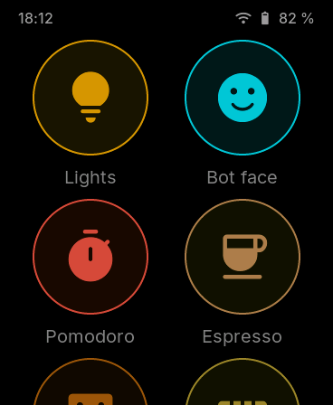
  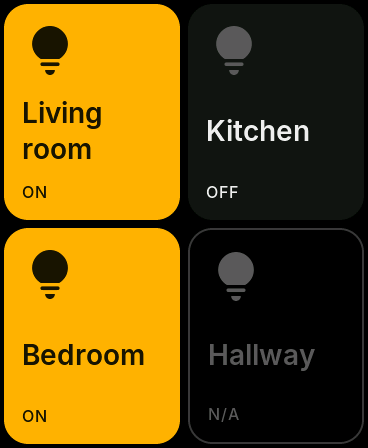
  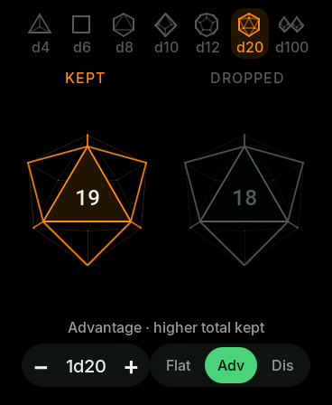
  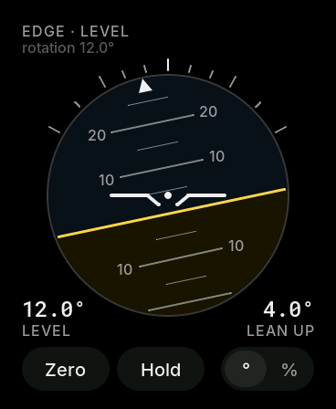
  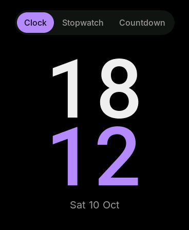
  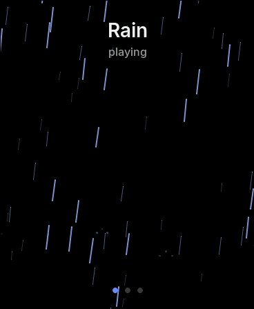
</p>

> **Status:** everything builds, the logic is unit-tested and every screen
> runs in a PC simulator (the screenshots here come from it), but **it has
> not been tried on a real board yet**. Expect rough edges on first flash;
> the bring-up checklists are in [docs/ROADMAP.md](docs/ROADMAP.md).

## What it can do

- **Menu** of round app icons, two per row, scrolling. The status bar shows
  the time, Wi-Fi and battery; pull it down for **quick settings**: pick a
  Wi-Fi network (typed on a Nokia-style keypad), set the brightness and the
  volume, or mute.
- **Lights**: four Home Assistant lights as big tap-to-toggle tiles.
- **Bot face**: a friendly animated face that reacts to taps.
- **Pomodoro**: 25 / 5 / 15 min focus timer that keeps running in the
  background, with a power-saving minimal view.
- **Espresso**: a shot timer with a target band and your last shots.
- **Dice**: 3D wireframe d4, d6, d8, d10, d12, d20 and d100; up to 10 dice;
  advantage and disadvantage.
- **Level**: a bubble level lying flat, an inclinometer standing on an edge.
- **Timer**: a big clock for presenting that never blanks (and never burns
  in), a stopwatch, and a countdown up to 99:59.
- **Noise**: rain with falling rain on screen; swipe for white or blue
  noise. Keeps playing while you use other apps.
- **System**: battery, Wi-Fi, memory, uptime and the **wireless update**
  screen.

It also looks after itself: it dims and blanks the screen when idle, sleeps
deeply on battery, keeps the screen on while a timer needs it, shifts the
picture a few pixels now and then so the AMOLED doesn't burn in, and updates
over Wi-Fi.

## Quick settings

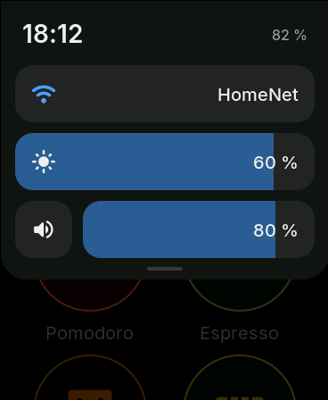
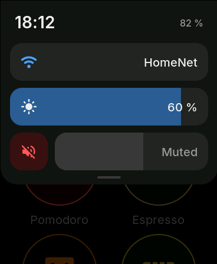
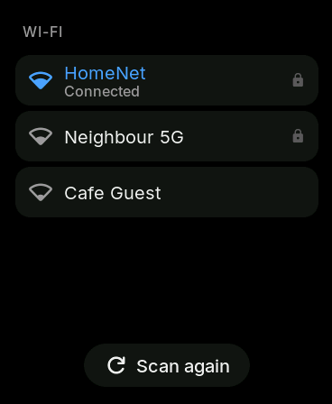
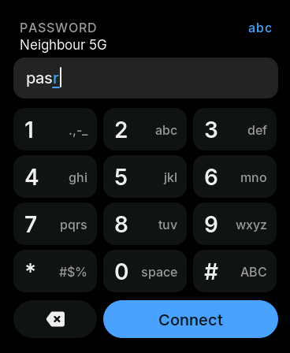
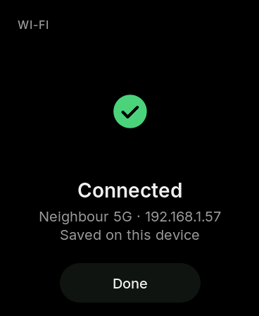

In the menu, **drag the status bar down** (or tap it) and a shade slides
over the menu, like on a phone:

- **Wi-Fi**: shows the network in use. Tap it to pick another: the board
  scans, you tap a network and type its password on a phone keypad the old
  way. Tap 2 three times for "c", wait a moment (or press another key) to
  move on; **#** switches between abc, ABC and 123, **\*** has the symbols,
  **0** is space, ⌫ deletes. Then **Connect**. The network is remembered
  only once it actually connects, so a typo can't lock you out of the old
  one.
- **Brightness**: one big bar from 5 % to 70 %. Touch or slide along it and
  the screen follows your finger; it's remembered when you let go.
- **Volume**: the button on the left mutes everything (beeps and noise; it
  turns red); the bar sets the volume from 0 to 100 %. Slide it while noise
  plays to hear the level, or let go and it blips once at the new volume.

All settings stay through restarts, sleep and firmware updates. Drag the
shade up, tap below it or press a button to close it.

## The apps

### Lights (Home Assistant)


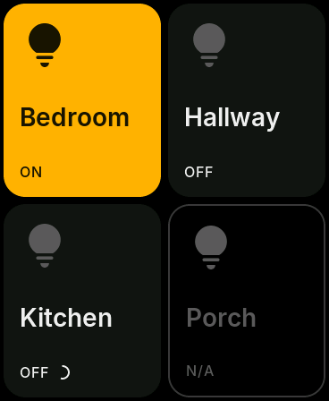

Tap a tile to switch that light. A small spinner shows until Home Assistant
confirms; if it fails, the tile shakes and keeps its state. States refresh
every 3 s while the app is open. Greyed tiles are lights HA doesn't know or
can't reach. A red banner means the access token was rejected.

### Bot face


It blinks and looks around on its own. Tap it and it's happy; tap twice
quickly and it's surprised. When the screen dims it gets sleepy.

### Pomodoro

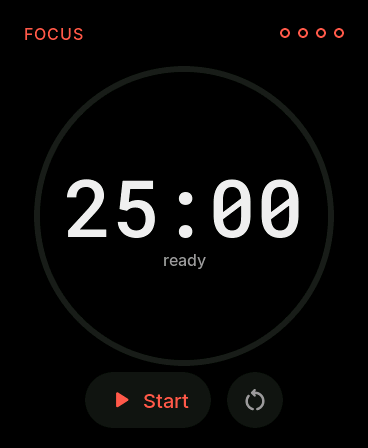
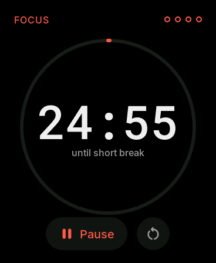
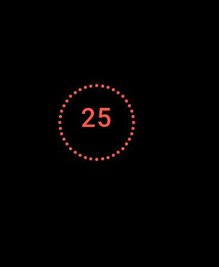

Tap the ring (or Start) to start and pause. Long-press the ring to skip to
the next phase. Reset asks for a second tap. Four focus sessions make a set,
then comes a long break; the dots in the corner count them. It beeps and
flashes at the end of each phase.

The timer keeps running when you leave the app. While it runs, the screen
never turns off: after the idle time it switches to the dim **minimal view**
(minutes and a dotted ring, moving slightly every minute) and the chip
sleeps between updates. Touch or press a button to get the full view back.

### Espresso

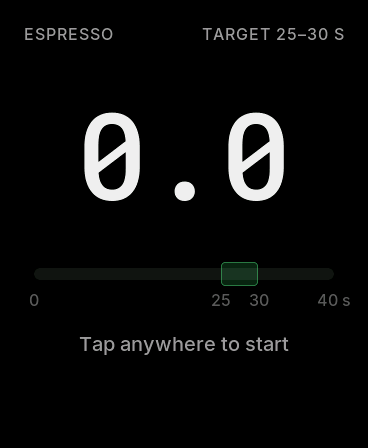
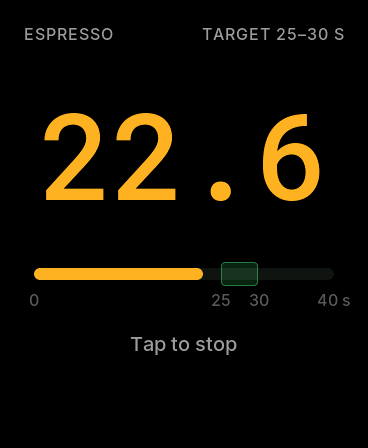
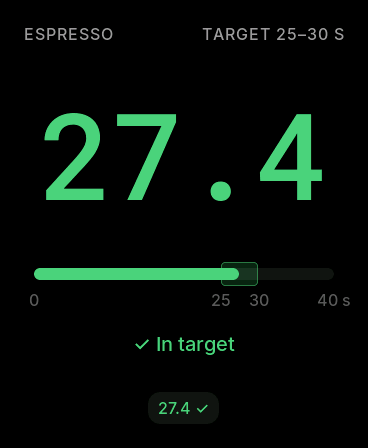

Tap **anywhere** to start, tap again to stop (your hands are busy). The
colour tells you where you are against the target (25–30 s by default):
blue early, amber close, green in target, red too long. The last four shots
sit at the bottom, ✓ when they hit the target. Long-press to throw away the
shot you just pulled; tap or Back to get ready for the next one.

### Dice

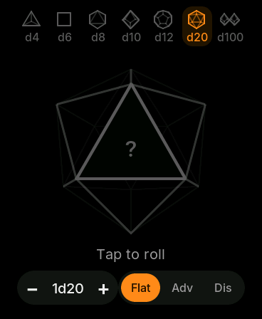
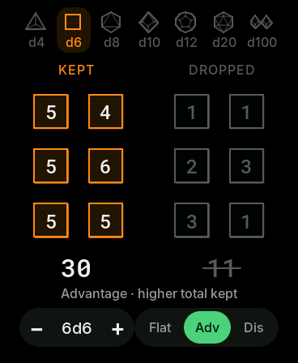
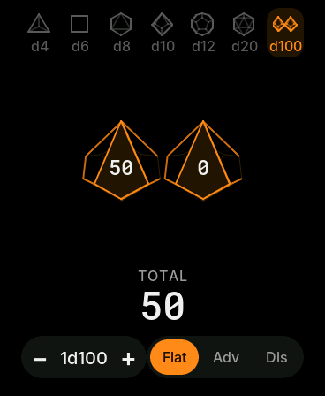

Pick a die in the top strip, set how many with − / +, choose **Flat**,
**Adv** (roll twice, keep the higher total, green) or **Dis** (keep the
lower, red), then tap the middle to roll. The dice spin and always land
flat on a face. A natural 20 or 1 on a single d20 lights up green or red. A
d100 is two d10s, tens and ones. The choice is remembered.

### Level

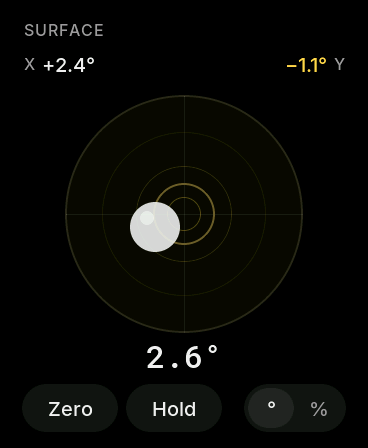
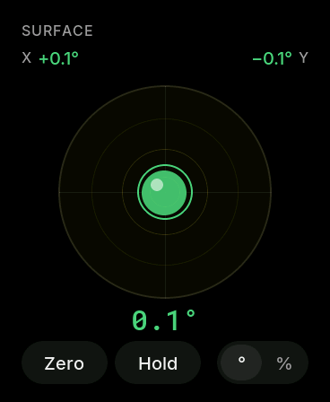


**Lying flat** it's a bullseye bubble: X and Y tilt at the top, the total
under the vial. **Standing on an edge** it turns into an aircraft-style
horizon: bottom left is how far you are from level (or plumb, when on its
side), bottom right how far the screen leans up or down. Everything turns
green within 0.3° and beeps once.

- **Zero**: measure relative to the current surface (tap again to reset).
- **Hold**: freeze the reading.
- **° / %**: degrees or percent slope.

### Timer


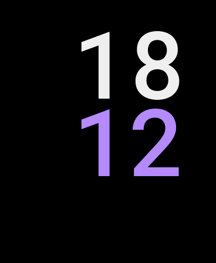
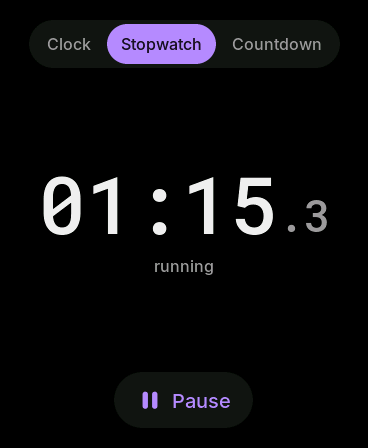
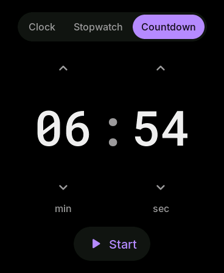
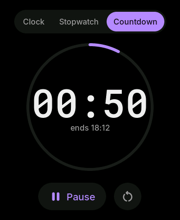
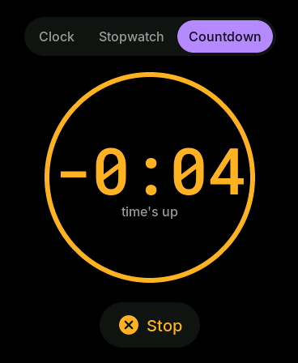

Three tabs at the top:

- **Clock**: hours over minutes, as big as the screen allows, and the date.
  Put it on the lectern while you present: the screen **never turns off**.
  After the idle time it switches to a dim view with only the digits (a
  quarter of full brightness, still readable across a room), which moves to
  a new spot every minute so nothing burns into the AMOLED, and the chip
  sleeps between minutes.
- **Stopwatch**: tap the digits or Start / Pause; ⟲ resets while paused.
- **Countdown**: set minutes and seconds (up to 99:59) by dragging each
  number up or down, or tapping above / below it (hold to repeat). Start it
  and a ring shows the time gone and when it will end. When time's up it
  beeps for 30 s, the screen wakes and flashes, and it counts the overtime
  in amber until you press Stop (Back just silences it).

The stopwatch and countdown keep running when you leave the app, with the
same dim, moving view while the device is idle. The countdown remembers its
last time.

### Noise

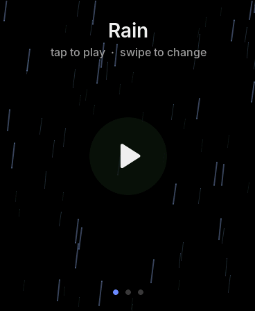

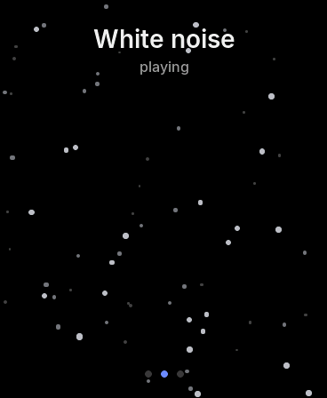
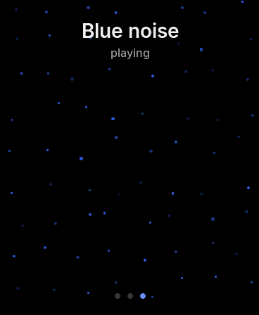

Tap to play or pause the **rain**. **Swipe left or right** to cycle through
rain, **white noise** and **blue noise** (the dots at the bottom show which).
Every sound is generated live and has its own picture: falling rain with
splashes, drifting snow, twinkling blue points.

It's made for long sessions. The labels fade out after a few seconds, the
picture never stands still, and the screen dims and goes black as usual
while the sound plays on, in the menu and in other apps too (open Noise
again to pause it). The board won't deep-sleep while it plays, so on
battery it lasts hours, not days. Volume and mute are in quick settings.

### System

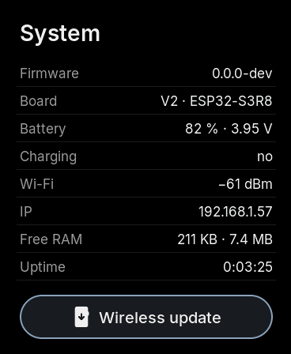
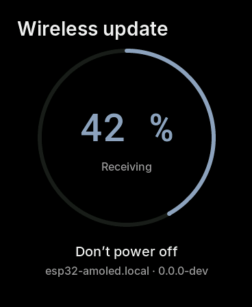

Firmware version, board revision, battery and charging, Wi-Fi signal and IP,
free memory, uptime. **Wireless update** opens the update screen (see
[Updating over Wi-Fi](#updating-over-wi-fi)).

## Using the device

| Do this | What happens |
| --- | --- |
| Tap / swipe the screen | use the app; swipe the menu up and down |
| **BOOT** button, short press | **Back** (inside an app first, e.g. the espresso result, then to the menu) |
| **PWR** button, short press | **Home**: straight to the menu |
| Either button, **hold 1 s** | power-off animation, then deep sleep |
| **BOOT** while asleep | wake up into the menu |
| Any touch or button while dimmed / black | screen comes back (that touch isn't passed to the app) |


**Power.** On battery the screen dims after 10 s, goes black after 15 s and
the board deep-sleeps after 20 s idle (Espresso and Level wait longer; a
running Pomodoro, the Timer's clock or a running timer never sleep and show
a dim minimal view instead; playing Noise blanks the screen but doesn't
sleep). On the charger it dims after 1 min, goes
black after 5 min and never sleeps. Apps remember their state across sleep
(Pomodoro comes back paused). All timings are in `include/config.h`.

## Getting started

You need the board (V1 or V2, detected automatically), a USB-C cable, and
[VS Code](https://code.visualstudio.com/) with the **pioarduino IDE**
extension (suggested automatically when you open the folder), or PlatformIO
Core (`pip install platformio`).

1. **Clone** the repo and open the folder in VS Code.
2. **Add your settings.** Copy the template and fill it in:
   ```bash
   cp include/secrets.example.h include/secrets.h
   ```
   - `WIFI_SSID`, `WIFI_PASSWORD`: your 2.4 GHz Wi-Fi. Optional: you can also
     pick the network on the device (quick settings → Wi-Fi), which then
     wins over these. You still need Wi-Fi for wireless updates and lights.
   - `HA_BASE_URL`, `HA_TOKEN`: your Home Assistant address (e.g.
     `http://192.168.1.10:8123`) and a long-lived access token (HA →
     your profile → Security → Long-lived access tokens).
   - `OTA_PASSWORD`: any password; it protects wireless updates.

   `secrets.h` is ignored by git, so it never gets committed. Without it the
   firmware still builds but stays offline.
3. **Pick your lights.** Set the four entity IDs and names in `HA_LIGHTS` in
   `include/config.h`.
4. **Flash over USB** (the first time has to be USB):
   ```bash
   pio run -e amoled -t upload -t monitor
   ```
   or in VS Code: **Terminal → Run Task… → ESP: build & upload & monitor**.
   If the board doesn't show up: hold **BOOT**, unplug and replug USB,
   release BOOT, try again.

## Updating over Wi-Fi

After the first USB flash you can update without a cable.

1. On the board, open **System → Wireless update**. It joins Wi-Fi and shows
   **Waiting for upload** with its IP address.
2. On your PC, in a terminal, set the same password as `OTA_PASSWORD`
   (once per terminal session):
   ```bash
   export ESP_OTA_PASSWORD='your-ota-password'          # macOS / Linux
   $env:ESP_OTA_PASSWORD = 'your-ota-password'          # Windows PowerShell
   ```
3. Build and send it:
   ```bash
   pio run -e amoled-ota -t upload
   ```
   or **Run Task… → ESP: upload OTA (Wi-Fi)**.

The ring fills up while it receives (don't power off; Back and Home are
blocked meanwhile), shows **Updated**, plays the power-off animation and
restarts into the new version. Check it under **System → Firmware**.

**It's hard to brick.** The flash holds two copies of the firmware; an
update goes into the one that isn't running. The new version only counts as
good once it has run for 10 s. If it crashes or resets before that, the board
automatically goes back to the previous version.

**It only listens while that screen is open**, so nothing on the network can
update it behind your back. It refuses to start with no `OTA_PASSWORD`, or
below 30 % battery unless it's on the charger.

**If the upload can't find the board** (some networks don't resolve `.local`
names), use the IP from the update screen:

```bash
pio run -e amoled-ota -t upload --upload-port 192.168.1.42
```

If you rename the device (`OTA_HOSTNAME` in `config.h`), change `upload_port`
in `platformio.ini` to match.

## Make it yours

Everything you'd want to tweak is in **`include/config.h`**:

| What | Where |
| --- | --- |
| Lights and refresh rate | `HA_LIGHTS`, `HA_POLL_MS` |
| Brightness range and default (the level itself is set in quick settings) | `BRIGHTNESS_USER_*` |
| Dim / black / sleep timings | `BAT_IDLE_*`, `CHG_IDLE_*` |
| Pomodoro lengths, set size, auto-start, sound | `POMO_*` |
| Espresso target band | `ESPRESSO_TARGET_MIN_S`, `ESPRESSO_TARGET_MAX_S` |
| Dice colour and roll time | `DICE_COLOR`, `DICE_ROLL_MS` |
| Level colour, beep | `LEVEL_COLOR`, `LEVEL_BEEP` |
| Bot face colour | `BOT_FACE_COLOR` |
| Timer colour, first countdown, minimal-view brightness | `TIMER_COLOR`, `TIMER_DEFAULT_COUNTDOWN_S`, `TIMER_MINIMAL_BRIGHTNESS` |
| How long a finished countdown beeps | `SOUND_ALARM_MS` |
| Noise colour, animation speed, fade | `NOISE_*` |
| Volume default and range (the level itself is set in quick settings) | `SOUND_VOLUME_DEFAULT_PCT`, `SOUND_VOLUME_RANGE_DB` |
| Device name on the network | `OTA_HOSTNAME` |

Rebuild and flash (USB or Wi-Fi) after changing it.

## Troubleshooting

| Problem | Try |
| --- | --- |
| Board doesn't appear as a serial port / upload fails | hold BOOT, replug USB, release BOOT, upload again |
| Lights show "Connecting…" forever | pick the network again in quick settings → Wi-Fi (2.4 GHz only), or check `WIFI_SSID` / `WIFI_PASSWORD` |
| Wi-Fi: "Couldn't connect" | wrong password (try again, mind ABC / abc), or too far from the router |
| Forget the saved Wi-Fi, brightness and volume | "ESP: erase flash", then flash again |
| No sound at all | quick settings: is the speaker button red (muted), or the volume at 0 %? |
| "HA token rejected" | create a new long-lived token, update `HA_TOKEN` |
| A light tile is grey | wrong entity ID in `HA_LIGHTS`, or the light is offline in HA |
| Wireless update: "Wrong password" | `ESP_OTA_PASSWORD` on the PC ≠ `OTA_PASSWORD` on the board |
| Wireless update: no device found | use `--upload-port <IP from the screen>`; PC and board on the same network |
| Level reads wrong axes | see the axis check in [docs/apps/level.md](docs/apps/level.md) |
| No serial output | the release build only logs errors; use `amoled-debug` |

---

## For developers

The rest is for working on the firmware. Start with [AGENTS.md](AGENTS.md)
(it's written for AI agents, but it's the shortest tour for humans too).

### Documentation

| File | What's in it |
| --- | --- |
| [docs/HARDWARE.md](docs/HARDWARE.md) | board spec, pinout, I2C map, chip notes |
| [docs/ARCHITECTURE.md](docs/ARCHITECTURE.md) | app framework, power and sleep, Home Assistant, OTA |
| [docs/apps/](docs/apps/) | one spec per app, and how to add an app |
| [docs/UI_DESIGN.md](docs/UI_DESIGN.md) | colours, type, spacing, icons, asset pipeline |
| [docs/ROADMAP.md](docs/ROADMAP.md) | milestones with on-device checklists |
| [docs/DECISIONS.md](docs/DECISIONS.md) / [docs/LESSONS.md](docs/LESSONS.md) | why things are the way they are / gotchas |
| [docs/LIBRARIES.md](docs/LIBRARIES.md) | dependencies, versions, licences |

### Layout

```
ESP32-AMOLED/
├── include/
│   ├── board.h              hardware pins & I2C addresses (fixed by the PCB)
│   ├── config.h             tunables (committed)
│   ├── lv_conf.h            LVGL configuration
│   ├── secrets.example.h    template for secrets.h (Wi-Fi, HA, OTA); secrets.h is gitignored
│   └── secrets_or_example.h picks secrets.h, or the template when it's missing
├── src/
│   ├── main.cpp             wiring: setup() bring-up, loop() servicing
│   ├── core/                hardware + system services (display, touch, power, net, OTA, …)
│   ├── apps/                app framework + one folder per app
│   └── ui/                  theme and shared widgets, drawing helpers, generated fonts/icons
├── lib/                     Arduino-free logic, unit-tested on the PC
├── test/                    Unity tests for lib/
├── assets/                  font sources + assets.toml (input of tools/assets.py)
├── tools/                   asset generator, version/size scripts, sim/ (PC simulator)
├── data/                    files for the LittleFS partition (unused so far)
├── docs/                    see the table above; design/ has mockups and simulator screenshots
├── partitions.csv           16 MB: 2 × 4 MB app slots (OTA), ~8 MB LittleFS, core dump
├── platformio.ini           build environments
├── .vscode/tasks.json       build / flash / monitor tasks
└── .github/workflows/       CI
```

### Build environments

| Env | Purpose |
| --- | --- |
| `amoled` | release (default): logs errors only |
| `amoled-debug` | debug: verbose logs, LVGL warnings |
| `amoled-ota` | the release build, uploaded over Wi-Fi |
| `native` | host unit tests for `lib/` |
| `sim` | PC simulator + UI flow test |

```bash
pio run -e amoled                    # build → .pio/build/amoled/firmware.bin
pio run -e amoled -t upload          # flash over USB
pio run -e amoled-ota -t upload      # flash over Wi-Fi
pio device monitor                   # serial, 115200
```

The build prints the image size and fails above 3.5 MiB (it's ~1.6 MiB).

### VS Code tasks

**Terminal → Run Task…** (the default build is `Ctrl/Cmd+Shift+B`):

| Task | Does |
| --- | --- |
| ESP: build | compile |
| ESP: build & upload & monitor | compile, flash over USB-C, open serial |
| ESP: upload | compile + flash |
| ESP: upload OTA (Wi-Fi) | flash over Wi-Fi (open System → Wireless update first, set `ESP_OTA_PASSWORD`) |
| ESP: monitor | serial monitor (115200) |
| ESP: upload filesystem (data/) | flash the LittleFS image built from `data/` |
| ESP: clean | delete build output |
| ESP: erase flash | wipe the whole chip (settings, filesystem, app) |
| Test: unit tests (PC) | `pio test -e native` |
| Test: UI simulator + screenshots (PC) | run every app on the PC, check the flow, regenerate the screenshots |
| Assets: regenerate fonts/images | `python tools/assets.py` after editing `assets/` |

### Tests and the simulator

```bash
pio test -e native                         # logic unit tests
pio run -e sim && .pio/build/sim/program   # every app on the PC, scripted taps and checks
python tools/sim/shots.py                  # frames → docs/design/screens/ (needs Pillow)
python tools/assets.py --check             # generated fonts match assets/ (tools/requirements.txt + npm ci)
```

All of these must pass before pushing, with 0 compiler warnings. CI
(`.github/workflows/build.yml`) runs them on every push and PR, attaches
`firmware.bin` and the simulator screenshots, and fails on any difference in
the generated assets.

### Contributing

Small changes go straight to `main`; large features get a
`feature/<name>` branch and a PR. Update the docs in the same commit as the
code, record decisions in [docs/DECISIONS.md](docs/DECISIONS.md) and gotchas
in [docs/LESSONS.md](docs/LESSONS.md).
