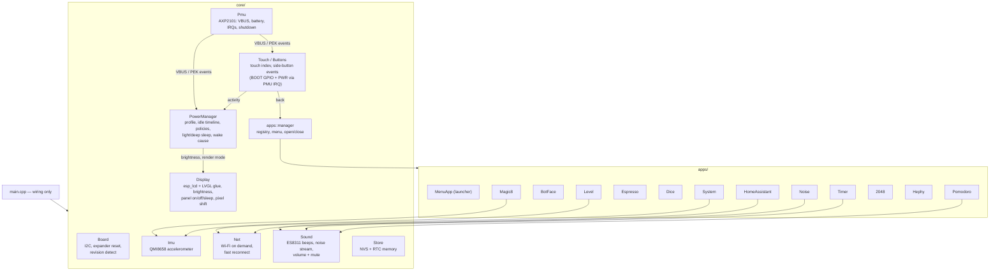
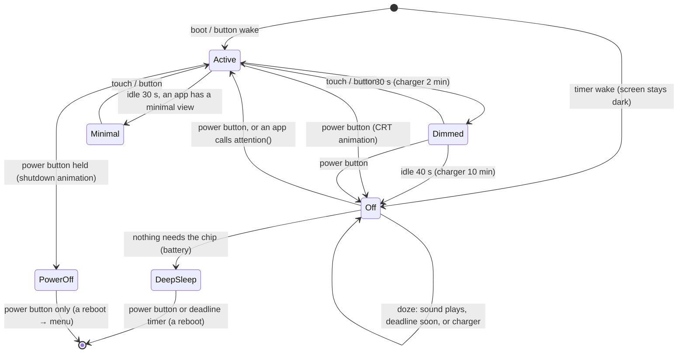

# Architecture

> **Status: implemented, not yet verified on hardware** (see
> [ROADMAP.md](ROADMAP.md)). Where the code differs from the original plan,
> the section says so ("*Implemented:*"); update this file whenever the
> design changes. Per-app specs live in
> [docs/apps/](apps/README.md). Open questions are collected at the end.

## 1. Goals

1. An **app menu** for 10+ apps: round icons in pairs, scrolling vertically.
   Tap an icon to open the app. Two side buttons, like a phone: one is
   **Power** (screen off / power off), the other goes **back** one step
   (press) or **home** to the menu (hold).
2. Apps (first set, each specified in `docs/apps/`):
   - [Home Assistant lights](apps/home-assistant.md): 2×2 grid toggling 4 lights on the LAN
   - [Bot face](apps/bot-face.md): animated smiley face
   - [Pomodoro](apps/pomodoro.md): focus/break timer that keeps the screen on at minimal power
   - [Espresso shot timer](apps/espresso-timer.md): stopwatch for espresso shots
   - [Dice](apps/dice.md): wireframe dice roller
   - [Level](apps/level.md): spirit level and inclinometer (QMI8658 IMU)
   - [Timer](apps/timer.md), [Noise](apps/noise.md): clock / stopwatch / countdown; rain and noise
   - [Magic 8-ball](apps/magic8.md): shake for an answer (IMU)
   - [2048](apps/g2048.md): the sliding-tile game
   - [Hephy](apps/hephy.md): a virtual pet on the wall clock, with the Bot face's face
   - [System](apps/system.md): version, battery, Wi-Fi, memory, and **wireless firmware update (OTA)**
3. **Power like a phone's, at a fraction of the drain:** the screen dims and
   goes off after a while or when the power button is pressed. With the
   screen off the apps say what they still need (§8): sound keeps the chip
   dozing, a deadline (a countdown) sets a deep-sleep timer, anything else is
   plain deep sleep. Waking brings back the app that was on screen. Holding
   the power button powers off: deep sleep with everything stopped.
4. **Two power profiles:** on battery (~400 mAh cell) the screen goes off
   after 40 s idle and the chip deep-sleeps whenever it can; on the charger
   the screen stays on longer and the chip only dozes. The AMOLED is
   protected by pixel shift, drifting minimal views and the screen going off.
5. Adding an app = one folder + one line of registration, no core changes.

### Non-goals (for now)

On-device Wi-Fi setup (credentials come from `secrets.h`),
audio beyond short beeps, settings UI (later app).

## 2. User-facing behaviour

### 2.1 App menu (launcher)

```
┌──────────────────────────┐   368 × 448 portrait, black background
│ 12:34        ▂▄▆  🔋 82% │   status bar (time, Wi-Fi, battery / ⚡)
│                          │
│    ╭─────╮    ╭─────╮    │   round icons, 128 px diameter, 
│    │ 💡  │    │ 🙂  │    │   2 per row, label under each
│    ╰─────╯    ╰─────╯    │
│    Lights     Bot face   │   vertical scroll with snapping to rows,
│                          │   momentum, scrollbar fades out
│    ╭─────╮    ╭─────╮    │
│    │ 🍅  │    │ ☕  │    │   rows scale slightly toward the centre
│    ╰─────╯    ╰─────╯    │   (watch-style fisheye) — optional polish
│   Pomodoro    Espresso   │
│    ╭─────╮    ╭─────╮    │
│    ┆     ┆    ┆     ┆    │   ← next row peeks in, hinting more apps
└──────────────────────────┘
```

- About 2½ rows are visible, so the partial row signals "scroll for more".
- Tap an icon → it scales up briefly → the app opens (zoom/fade transition).
- The order is the registration order in `main.cpp`. A "recently used first"
  order can come later.
- The menu remembers its scroll position.
- *Implemented:* the fisheye fades rows away from the centre (colour opacity
  down to ~60 %) instead of scaling them, which would need a layer per row;
  a tap shrinks the disc while pressed, then the app fades in.

### 2.2 Navigation — two side buttons, like a phone

| Button | Role | Signal path |
| --- | --- | --- |
| **BOOT** (GPIO0) | **Power**: press = screen off (sleep), hold = power off; wakes the device | GPIO, debounced in firmware; an RTC GPIO, so it wakes light and deep sleep (ext1) |
| **PWR** (AXP2101 PEK) | **Back** (press) and **Home** (hold) | PMU short/long-press IRQs, polled over I2C |

The power button has to be BOOT: PWR only reaches the ESP through the
AXP2101 (whose IRQ goes to the TCA9554, not to a GPIO), so it can't wake the
chip (§8.4, DECISIONS 2026-10-18).

| Input | Effect |
| --- | --- |
| Tap icon in the menu | open the app |
| **Back** (PWR press) | the app handles it first (`onBack()`: close a dialog, leave a sub-screen, silence an alarm …); if the app has nothing to go back to → menu. In the menu: close the shade, else scroll to top. |
| **Home** (PWR held ≥ `BUTTON_LONG_PRESS_MS`, 1 s) | always → menu (scroll to top if already there) |
| **Power** (BOOT press) with the screen on | the CRT screen-off animation → screen off; the apps decide how deep the chip sleeps (§8) |
| **Power** with the screen off, or on a minimal view | screen on, same app as before (after a deep sleep too, §8.4) |
| **Power held** (≥ `BUTTON_POWER_OFF_MS`, 1.5 s) | the longer shutdown animation → **power off**: deep sleep until the power button, timers paused, sound stopped; the next start shows the menu |
| PWR held ~6 s | hardware power-off by the AXP2101 (firmware can't block it) |
| Touch, Back or Home while dimmed or on a minimal view | wake the screen only; the input is swallowed |
| Touch, Back or Home with the screen off | nothing: touch is asleep, only Power wakes |

"Home" can never be overridden by an app, so no app can trap the user. During
an OTA transfer (`blocksNavigation()`) Back, Home and Power are ignored.

### 2.3 Visual rules (AMOLED)

On AMOLED a black pixel is off: it costs no power and doesn't wear.

- Black backgrounds everywhere. Colour goes on the content, never on full-screen fills.
- Large bright areas only briefly (e.g. a light tile that is ON uses a warm
  colour fill, but only while the HA app is open).
- Static elements (status bar, labels) are subject to **pixel shift** (§7).

## 3. Power profiles

The **PowerManager** picks a profile from the AXP2101: `isVbusIn()` →
**Charger**, otherwise **Battery**. VBUS insert/remove IRQs switch profiles
live.

| | Battery | Charger |
| --- | --- | --- |
| Active brightness | the user's setting, 5–70 % (quick settings, default 60 %) | same |
| Idle → dim | 30 s → half of it, at most 25 % | 2 min → half of it, at most 40 % |
| Idle → screen off | 40 s | 10 min |
| Screen off | deep sleep unless an app needs the chip (§8) | doze: the chip stays up, light-sleeping |
| Wi-Fi | only while an app needs it, never with the screen off | same |
| Pixel shift | yes | yes |

All numbers live in `config.h` (§9).

### 3.1 Per-app power policy

Each app declares how it interacts with the idle timeline while the screen
is on:

| Policy | Meaning | Used by |
| --- | --- | --- |
| `Normal` | follow the profile's dim → screen off timeline | menu, Home Assistant, bot face (1 min dim delay), Hephy (1 min), dice, Magic 8, 2048, level (1 min), espresso and System when idle, Noise |
| `KeepAwake` | full UI stays on while the app says it's busy | espresso timer *while running*, System *while the update screen is open* |
| `LowPowerDisplay` | after the dim timeout switch to the app's **minimal render mode** (few dim pixels, rare refresh, CPU light-sleeps between refreshes) instead of going off | pomodoro *while a timer runs* (also in the background); Timer *on the clock tab* and *while a stopwatch or countdown runs* |

A policy can change at runtime: the manager asks the open app for
`powerPolicy()` every loop (and closed apps for `backgroundPolicy()`), so the
espresso timer is `KeepAwake` only while the stopwatch runs. An app can also
lengthen its dim delay with `idleDimMs()` (espresso, level, bot face).
`KeepAwake` (open app) beats a minimal view (open or background app), which
beats `Normal`.

**Policies beat profiles.** A non-`Normal` policy behaves the same on the
charger as on battery. A running pomodoro switches to its minimal view after
the *battery* dim delay even while charging; the charger profile only keeps
its brightness cap. The charger timeline (2 min dim, 10 min off) applies only
to `Normal` apps.

What happens **once the screen is off** is a separate question every app
answers with `sleepNeed()` (§8.2): Noise needs the chip awake while it plays,
a running countdown or pomodoro needs a wake at its end.

## 4. Hardware used

| Part | Use | Notes |
| --- | --- | --- |
| CO5300 AMOLED (QSPI) | UI | brightness cmd `0x51`; display off `0x28` / on `0x29`; sleep-in `0x10` / out `0x11`; partial updates must be **even-aligned** (x1, y1 even; x2, y2 odd); the panel keeps its image in its own RAM, so the ESP can light-sleep while it stays on |
| CST820 touch (I2C `0x15`, INT GPIO21) | input | LVGL pointer device; INT is an RTC GPIO → light-sleep wake source |
| TCA9554 (I2C `0x20`) | LCD/touch reset EXIO0–2, PWR key EXIO4, PMU IRQ EXIO5 | reset pulse at every boot, and when the screen comes back on (the touch controller only leaves its sleep through it) |
| BOOT button (GPIO0) | side button **Power**: screen off / power off, the only wake button | RTC GPIO → light-sleep GPIO wake and deep-sleep ext1 wake (active low) |
| PWR button (AXP2101 PEK) | side button **Back** (press) / **Home** (hold); 6 s hold = hardware off | short/long-press IRQs via EXIO5, polled; can't wake the chip (§8.4) |
| AXP2101 PMU | VBUS detect, charging, battery %, power-off/on | XPowersLib: `isVbusIn()`, `isCharging()`, `getBatteryPercent()`, `shutdown()`, VBUS insert/remove + PEK IRQs |
| ES8311 + speaker amp (PA GPIO46) | short beeps (pomodoro phase end) | amp off except while beeping |
| QMI8658 IMU | Level app (accelerometer, own `core/imu` driver): powered down, oscillator off, except while Level is on screen | optional |
| microSD slot | not used (no card, and none planned): its lines stay untouched | — |
| PCF85063 RTC | wall clock in the status bar; the time asleep for `core::mono()` (§8.5) | keeps time through deep sleep and AXP power-off |
| ESP32-S3 Wi-Fi | Home Assistant | station mode, only when needed on battery |

## 5. Software stack

Full list with versions, licences and the options we rejected:
[LIBRARIES.md](LIBRARIES.md). Design system, fonts, images, sprites and the
asset pipeline: [UI_DESIGN.md](UI_DESIGN.md).

| Layer | Choice |
| --- | --- |
| Framework | Arduino core 3.x (pioarduino), ESP-IDF APIs where needed (sleep, PM, esp_lcd) |
| UI | **LVGL 9.6**, rendering `RGB565_SWAPPED`, partial mode, 2 DMA buffers |
| Display | **esp_lcd** QSPI panel IO (async DMA) + panel commands ported into `src/core/display.cpp` |
| Touch / IMU / RTC | own drivers (`core/touch`, `core/imu`, `core/rtc_clock`) |
| PMU | XPowersLib |
| IO expander | own TCA9554 driver |
| Audio | ES8311 register setup ported into `core/sound` + core `ESP_I2S` |
| Network / data | core `WiFi`, `HTTPClient`, ArduinoJson 7 |
| Storage | `Preferences` (NVS), `LittleFS`, `RTC_DATA_ATTR` |
| Assets | `assets/` sources → `tools/assets.py` (lv_font_conv + LVGLImage.py) → `src/ui/generated/` |

## 6. Core services



Rules:

- Services don't know about specific apps; apps use services through small
  interfaces.
- Only the LVGL/UI task touches LVGL objects. Network and other slow work run
  in their own FreeRTOS tasks and report back through queues.

### 6.1 App interface

```cpp
// src/apps/app.h (trimmed)
struct AppInfo {
  const char *id;    // stable key for NVS ("pomodoro")
  const char *name;  // label in the menu
  const char *icon;  // ICON_* glyph from the icon font
  uint32_t accent;   // 0xRRGGBB
};

class App {
 public:
  virtual const AppInfo &info() const = 0;
  virtual void onCreate(lv_obj_t *root) = 0;  // build widgets; called on every open
  virtual void onDestroy() {}                 // widgets about to be deleted
  virtual void onTick(uint32_t nowMs) {}      // every loop while visible
  virtual void service(uint32_t nowMs) {}     // every loop, visible or not
  virtual bool onBack() { return false; }     // true = handled in-app, false = menu
  virtual bool blocksNavigation() const { return false; }  // e.g. OTA transfer running

  virtual power::Policy powerPolicy() const { return power::Policy::Normal; }       // while open
  virtual power::Policy backgroundPolicy() const { return power::Policy::Normal; }  // while closed
  virtual uint32_t idleDimMs() const { return 0; }                                  // 0 = profile default

  // LowPowerDisplay: draw a sparse, dim view into `layer` and say when the
  // next redraw is due; the CPU light-sleeps in between.
  virtual void enterMinimal(lv_obj_t *layer) {}
  virtual void exitMinimal() {}
  virtual void minimalTick(uint32_t nowMs) {}
  virtual uint32_t minimalRefreshMs(uint32_t nowMs) const { return 60000; }
  virtual uint8_t minimalBrightness() const { return 0; }  // 0 = BRIGHTNESS_MINIMAL (Timer: 25 %)

  virtual bool landscape() const { return false; }  // turn the screen (Level on its left edge)
  virtual void onRotated() {}                       // lay the widgets out again

  // The screen off (§8): every app's answer is merged by apps::manager.
  virtual sleepplan::Need sleepNeed(uint64_t monoNow) const { return {false, 0}; }  // awake? wake at?
  virtual void onSleep(sleepplan::Kind kind) {}  // deep sleep (Sleep) or power-off: park state
  virtual void onWake(Wake wake) {}              // once per boot, before onCreate: restore
  virtual void onScreen(bool on) {}              // screen off/on while the chip runs (open app)
  virtual bool resumable() const { return true; }  // reopened by a button wake
  virtual ~App() = default;
};
```

`apps::manager` holds the registered apps (static instances in `main.cpp`,
`apps::manager::add()`). Opening an app calls `onCreate()` on a fresh root
container; closing it calls `onDestroy()` and deletes the widgets, so only the
menu and the current app have widgets. Apps keep settings in NVS
(`core::store::save()`) when they change, and park their running state in RTC
memory in `onSleep()` (`core::store::park()`), to restore it in `onWake()`.
`manager::attention(app)` is how an app with news (a countdown ended) turns
the screen on and comes to the front.

### 6.2 File layout

```
src/
├── main.cpp           wiring: bring-up order in setup(), servicing in loop()
├── core/              board_init (I2C, TCA9554, revision), i2c_bus, display,
│                      touch, buttons, pmu, imu, power, net, ota, sound, rtc_clock,
│                      store, events
├── apps/
│   ├── app.h, app_manager.{h,cpp}
│   ├── menu/             launcher
│   ├── home_assistant/   ha_app, ha_client (FreeRTOS task)
│   ├── bot_face/
│   ├── pomodoro/
│   ├── espresso/
│   ├── dice/             wireframe dice roller
│   ├── level/            spirit level + inclinometer
│   ├── timer/  noise/
│   ├── magic8/           shake for an answer
│   ├── g2048/            2048
│   ├── hephy/            virtual pet (Bot face's face, lib/PetCore)
│   └── system/           info + wireless update
└── ui/
    ├── theme.{h,cpp}     design tokens and shared widgets
    ├── power_anim.{h,cpp} screen off / on and power-off animations
    ├── draw.{h,cpp}      immediate-mode drawing helpers (Dice, Level)
    └── generated/        fonts + icon codepoints from tools/assets.py (committed)
include/   board.h  config.h  secrets.example.h  lv_conf.h
lib/       Arduino-free logic (host-testable):
           PowerFsm/  SleepPlan/  ButtonLogic/  PomodoroCore/  TimerCore/  ShotTimer/  BotFace/  HaParse/
           PixelShift/  DiceCore/  LevelCore/  MultiTap/  NoiseGen/  SleepLog/  TouchCal/  WireRaster/
           EightBall/  Game2048/  PetCore/
test/      Unity tests for lib/ (run with `pio test -e native`)
assets/    asset sources + assets.toml        (UI_DESIGN.md §7)
tools/     assets.py, version.py, size_check.py, power_model.py, sim/ (PC simulator + screenshots)
docs/apps/ one spec per app
```

*Implemented:* the panel commands and the ES8311 setup are small ports inside
`src/core/` rather than vendored libraries; there is no `data/` (LittleFS)
content yet.

### 6.3 Runtime model

**Tasks**

| Task | Core | Priority | Owns |
| --- | --- | --- | --- |
| UI (Arduino `loop()`) | 1 | 1 (Arduino default) | LVGL (only task calling `lv_*`), app manager, PowerManager, input polling, Wi-Fi state machine (`core::net::loop()`), OTA |
| HA client | 0 | 3 | HTTP requests (started by the HA app) |
| Sound | 0 | 5 | I2S beep playback |

LVGL runs with `LV_OS_NONE`. Concurrency safety comes from ownership, not
locks: other tasks never touch UI objects.

**Event bus.** Cross-task and cross-module communication goes through one
FreeRTOS queue of small typed events, drained by the UI task once per frame
and dispatched to services and the current app:

```cpp
// src/core/events.h
enum class Ev : uint8_t { Back, Home, Power, PowerOff, WifiChanged, HaResult, HaLights, TimeSynced };
struct Event { Ev type; uint32_t a; uint32_t b; };
bool events::post(const Event &e);  // any task
```

ISRs (touch INT) only set flags; the I2C work they trigger runs in the UI
task. `WifiChanged` is posted from `net::loop()` on a real link change, after
`net::connected()` has changed, so handlers always read the new state.

**I2C.** One bus with 7 devices. Every access goes through
`I2cBus::lock()` (FreeRTOS mutex). In practice almost all I2C traffic (touch,
PMU, RTC, expander) comes from the UI task.

**Memory.**

| What | Where |
| --- | --- |
| LVGL draw buffers (2 × ~29 KB) | internal DMA RAM |
| LVGL heap (widgets, styles), image cache | PSRAM |
| Network buffers, JSON documents | default heap (small, filtered `JsonDocument`s in `lib/HaParse`) |
| Fonts, images, sprites | flash (memory-mapped) |
| Stack sizes | UI 8 KB (Arduino loop task default), HA 8 KB, Sound 4 KB |

No allocation in per-frame paths; apps are static objects; screens are
created on open and deleted on close.

**Time.** The PCF85063 RTC is the clock source (it survives sleep and
power-off). When Wi-Fi is up, SNTP corrects it. Timezone is a POSIX TZ
string in `config.h` (`TIMEZONE`, e.g. `"CET-1CEST,M3.5.0,M10.5.0/3"`).
After a deep sleep the ESP's own clock, which kept running with sub-second
precision, is kept unless it drifted more than 1.5 s from the RTC. Timers
use `core::mono()`, a 64-bit millisecond clock that carries on through deep
sleep (§8.5).

**Settings.** Compile-time defaults in `config.h`. The settings changed on
the device, brightness, volume + mute and the Wi-Fi networks, live in
`core::settings` (NVS)
and are set from the [quick settings](apps/quick-settings.md) shade and the
[Wi-Fi screen](apps/wifi.md). Up to five networks are saved on the device
(most recent first), each with the channel, access point and DHCP lease
learned on its last connect; `WIFI_SSID` in `secrets.h` is the one more
known network (and is saved too once it connects). `net` rejoins the last
network straight on its channel, reusing a young lease as a static IP;
otherwise it scans and joins the strongest known one in range. A new network
is saved only after it connects (`net::join()`).
Everything else is read from `config.h` directly.

**Conventions.** C++17, one namespace per area (`core::`, `apps::`, `ui::`),
`.clang-format` (Google style: 2-space indent, 120 columns), no exceptions in firmware code, `ESP_LOGx` with a per-module tag.


## 7. AMOLED burn-in protection

These apply in both profiles. They matter most on the charger, where the
screen is on for hours.

1. **Brightness cap:** 80 % on the charger, configurable.
2. **Pixel shift:** every `PIXEL_SHIFT_PERIOD_MS` (default 3 min) the whole UI
   shifts by up to ±`PIXEL_SHIFT_MAX_PX` (default 4 px), along a slow
   Lissajous path so it never returns to the same spot on a regular beat.
   Implemented in the display driver: on each shift the whole screen is
   invalidated and the flush draws at the new offset, so apps don't have to
   care. Layouts keep a 4 px black safe margin on every edge.
3. **The screen goes off** after 40 s idle on battery and 10 min on the
   charger (`Normal` apps): panel asleep, every pixel off. The power button
   brings back the previous screen. (Before 2026-10-18 the timings were
   much shorter; they were relaxed to feel like a phone, which pixel shift
   and the drifting minimal views make safe.)
4. **Minimal render modes** (pomodoro, timer) use thin, dim elements, a ring
   rather than filled shapes, and also drift. The bot face wanders slowly
   around the screen while it's on (it stays bright a minute).
5. No app may show a full-screen bright fill for more than a few seconds.

## 8. Sleep, wake and persistence

*Rewritten 2026-10-18* for the phone-style power model (DECISIONS). The
pieces: `core::power` (stages, light/deep sleep), `lib/PowerFsm` (the idle
timeline), `lib/SleepPlan` (how deep to sleep), `apps::manager` (asks the
apps), `core::store` (RTC memory), `core::clock` (`mono()`).

### 8.1 Stages



Brightness changes fade over ~300 ms. **Off** means the panel is in its
sleep mode (display off `0x28`, sleep-in `0x10`), the touch controller is
asleep, LVGL rendering is paused and Wi-Fi is suspended. Coming back needs a
reset pulse through the expander (the only way out of the touch
controller's sleep, and it clears the panel), the panel init sequence and a
full redraw: about 200 ms, hidden behind the power-on animation.

### 8.2 With the screen off: what the apps need

Every app answers `sleepNeed(monoNow)` with a `sleepplan::Need`:

| Field | Meaning | Who |
| --- | --- | --- |
| `awake` | keep the chip running | Noise while it plays; Timer while its alarm rings |
| `wakeAtMs` | run again at this `core::mono()` time | a running countdown (its end), a running pomodoro (its phase end) |

`apps::manager::sleepNeed()` merges them (awake if any is, the earliest
wake) and `sleepplan::decide()` picks:

| Situation | What the chip does |
| --- | --- |
| power-off | deep sleep, only the power button wakes |
| an app needs it awake, or on the charger | **doze**: the loop keeps running with the CPU at 80 MHz; between passes it light-sleeps (up to `SLEEP_POLL_MS`, 5 s, or until the next deadline; wake on BOOT and the timer). While sound plays it doesn't light-sleep (that would stop the I2S stream). |
| a deadline within `SLEEP_MIN_DEEP_MS + SLEEP_WAKE_LEAD_MS` (5.6 s) | doze until it (a deep sleep isn't worth its reboot) |
| a later deadline | **deep sleep** with a timer, `SLEEP_WAKE_LEAD_MS` early (booting takes a while) |
| nothing | **deep sleep** until the power button |

In doze and after a deadline wake, apps keep getting `service()` every
loop. The one with news calls `apps::manager::attention(this)`: the screen
comes on (power-on animation) and the app comes to the front, whatever was
open (unless that blocks navigation, i.e. OTA).

The open app also gets `onScreen(false/true)` when the screen goes off and
on while the chip keeps running: Level powers the IMU down and up again with
it; Timer silences its alarm (the power button does, like a phone's).

### 8.3 Minimal view (`LowPowerDisplay`: pomodoro, timer)

Active → (dim timeout) → **Minimal**: the app redraws a sparse, dim view;
Wi-Fi is suspended; LVGL refreshes only when the app's `minimalRefreshMs()`
is due; between refreshes the ESP32-S3 enters **light sleep**. The panel
keeps showing its last frame from its own RAM. Wake sources: timer, touch
INT (GPIO21) and the power button (GPIO0); each sleep lasts at most
`SLEEP_POLL_MS` so the charger and PWR are still polled now and then. A
touch, a button or the power button returns to the full view. While sound
plays the CPU stays awake between redraws instead of light-sleeping. The
brightness is `BRIGHTNESS_MINIMAL` (15 %) unless the app asks for more with
`minimalBrightness()` (the Timer: 25 %), always capped at the user's.

### 8.4 Deep sleep, power-off and waking

**Entry** (`core::power::goDeepSleep()`), for a sleep and a power-off alike:

1. Confirm a pending OTA image (`ota::confirmIfPending()`): getting this far
   means it works, and a deep-sleep wake would otherwise roll it back.
2. Every app's `onSleep(kind)`: running state parked in RTC memory; on a
   power-off timers pause and noise stops first (Pomodoro also writes its
   paused state to NVS). The manager remembers the app on screen
   (`RtcState::lastApp`). Wait up to 1 s for noise to fade out.
3. Note the battery level and time for the drain log (§8.6), `mono()` and
   the wall clock for the wake (§8.5); commit `RtcState`.
4. Wi-Fi off. IMU powered down. Speaker amp off (PA_EN, GPIO46, held low
   through deep sleep: it isn't an RTC pin and would float). Panel and touch
   asleep. The AXP2101's voltage ADCs off (the fuel gauge keeps counting).
5. Wake sources: BOOT (ext1, pull-up kept in sleep); a timer if an app has a
   deadline (not after a power-off). `esp_deep_sleep_start()`.

The **power-off** differs only in what wakes it (the button alone) and in
step 2. It is a deep sleep, not an AXP2101 shutdown: an AXP shutdown can
only be ended by PWR, and the power button is BOOT (DECISIONS 2026-10-18).

**Waking is a reboot.** `setup()` reads the cause (`power::bootCause()`):

| Cause | What the apps get | Screen |
| --- | --- | --- |
| cold boot (power-on, reset, flashing) | `onWake(Cold)`: settings from NVS only | menu, power-on animation |
| power button after a sleep | `onWake(FromSleep)`: parked state | **the app that was on screen**, as it was (no menu, no fade) |
| power button after a power-off | `onWake(FromPowerOff)`: parked state, paused | menu |
| deadline timer | `onWake(FromSleep)` | stays off: the panel isn't even initialised. The apps run; if none calls `attention()` within `SLEEP_SILENT_WAKE_MS` (0.4 s) the device goes back to sleep with the next deadline. |

Target: the screen on < 500 ms after the press, behind the power-on
animation (the dot expands into the screen).

A press held from the wake is ignored (`BUTTON_WAKE_IGNORE_MS`), so waking
never turns into a power-off. *Still to verify on the board:* that holding
BOOT (a strapping pin) through a deep-sleep wake doesn't enter download
mode (ROADMAP M21).

### 8.5 Persistence

| What | Where | Survives |
| --- | --- | --- |
| running state of the apps (timers, last roll, menu scroll, last shot, last 8-ball answer, the 2048 board, Hephy since his last save) | RTC memory, `core::store::park()` | deep sleep and power-off (both are deep sleeps); not a reset or a flat battery |
| `mono()` and the wall clock at the sleep, the app on screen, the kind of sleep | `RtcState` | same |
| cached HA states (by list position) | `RtcState` | same |
| deep-sleep drain log (§8.6) | `RtcState` | same |
| the Home Assistant light list (`halights`) | NVS | everything but erase flash |
| espresso shot history, pomodoro settings and paused state (at a power-off), timer and dice settings, the 2048 board and best (on close and at a power-off), Hephy (`pet::State`, on every action) | NVS | same |
| brightness, volume + mute, touch calibration, saved Wi-Fi networks with channel / BSSID / lease | NVS (`core::settings`) | power-off and firmware updates (USB and OTA write only the app partition); not "erase flash" |

NVS writes happen only on user actions or a power-off, never periodically
and not at every sleep (flash wear): that's what RTC memory is for.

**`core::mono()`** is `core::extend(millis())` plus an offset kept across
deep sleep: going to sleep notes `mono()` and the wall clock, and the wake
adds the wall-clock time slept. TimerCore and PomodoroCore keep their
timestamps on it, so a running countdown is parked as it is and is still
right after the wake: its end is simply in the past or the future.

### 8.6 Battery life asleep

Goal: **at least a month in deep sleep** on the ~400 mAh cell. The budget
and how to measure it are in HARDWARE.md (Power → Deep-sleep current); what
each app costs open and asleep is estimated in [POWER.md](POWER.md)
(`tools/power_model.py`).

The device also measures it itself (`lib/SleepLog`, `core::power`): going
to sleep it notes the AXP2101 gauge level, the battery voltage and the wall
clock (PCF85063), and on the wake it compares. Sleeps on battery add up
until the next charge; the System app shows the result as **Standby** (days
a full charge lasts asleep) and the wake logs it:

```
I power: slept 14 h 05 min: 81 -> 80 % (3968 -> 3961 mV); since the last charge 38 h asleep, -2 %
I power: a charge lasts 79 days asleep
```

The gauge reads whole percent, so an estimate needs 2 % lost or a day
asleep (then it's a lower bound, "> n days"). A sleep that started on the
charger, or a level that rose (charged in between), starts the count over.

## 9. Configuration

`include/config.h` (committed) — sketch:

```cpp
// ---- power profiles ----
#define BRIGHTNESS_USER_MIN_PCT    5     // quick settings bar
#define BRIGHTNESS_USER_MAX_PCT    70
#define BRIGHTNESS_USER_DEFAULT_PCT 60
#define BRIGHTNESS_DIM_BATTERY     64    // 25 %
#define BRIGHTNESS_DIM_CHARGER     102   // 40 %
#define BRIGHTNESS_FADE_MS         300
#define BAT_IDLE_DIM_MS            30000
#define BAT_IDLE_OFF_MS            40000
#define CHG_IDLE_DIM_MS            120000
#define CHG_IDLE_OFF_MS            600000
// ---- sleep with the screen off (§8.2) ----
#define SLEEP_POLL_MS              5000  // longest light sleep (charger and PWR polls)
#define SLEEP_MIN_DEEP_MS          5000  // a closer deadline dozes instead
#define SLEEP_WAKE_LEAD_MS         600   // timer wakes come this early
#define SLEEP_SILENT_WAKE_MS       400   // a timer wake nobody needed sleeps again after this
#define DOZE_CPU_MHZ               80
// ---- buttons ----
#define BUTTON_LONG_PRESS_MS       1000  // PWR held → Home
#define BUTTON_POWER_OFF_MS        1500  // BOOT held → power off
#define POWER_OFF_ANIM_MS          1000  // screen off (CRT)
#define SHUTDOWN_ANIM_MS           2200  // power off
// ---- OTA (§12) ----
#define OTA_HOSTNAME               "esp32-amoled"
#define OTA_MIN_BATTERY_PCT        30
#define OTA_HEALTHY_AFTER_MS       10000
// ---- burn-in ----
#define PIXEL_SHIFT_PERIOD_MS      180000
#define PIXEL_SHIFT_MAX_PX         4
// ---- apps ----  (each app's own block, see docs/apps/*.md)
```

`include/secrets.h` (gitignored) gains `HA_BASE_URL`, `HA_TOKEN` and
optional static-IP fields. Placeholders go in `secrets.example.h`.

## 10. Error handling & logging

- Every module logs through `ESP_LOGx(TAG, …)` with a per-module tag
  (`board`, `display`, `power`, `ha`, …); the level comes from
  `CORE_DEBUG_LEVEL` (release: errors only, debug: debug level — verbose would log every I2C transfer).
- Missing peripherals (touch, IMU, codec) → log and continue without that
  feature. Only a missing display is fatal.
- App-specific failures are described in each app spec.

## 11. Testing

- **CI:** both firmware environments build (size budget enforced by
  `tools/size_check.py`), host tests and the simulator flow test run, and the
  generated assets are checked against their sources.
- **Host tests (`[env:native]` + Unity, `test/`):** pure logic lives in
  Arduino-free libraries under `lib/` (`PowerFsm`, `ButtonLogic`,
  `PomodoroCore`, `ShotTimer`, `BotFace`, `HaParse`, `PixelShift`, `DiceCore`,
  `LevelCore`, `MultiTap`, `EightBall`, `Game2048`, `PetCore`, …), so it compiles and runs on the PC. Adapters in
  `src/` connect them to hardware and LVGL. CI runs these tests next to the
  firmware builds.
- **Simulator (`[env:sim]`, `tools/sim/`):** the real apps, UI and LVGL run
  on the PC against stubbed hardware modules; `sim_main.cpp` taps through
  every app, checks the results and writes frames that `tools/sim/shots.py`
  turns into `docs/design/screens/` + `firmware-screens.png`.
- **On hardware:** each milestone's checklist in ROADMAP.md, run by the
  owner (agents can't flash). Measured currents and timings go into
  HARDWARE.md.

## 12. Firmware updates over Wi-Fi (OTA)

### 12.1 Does it fit?

Yes, by design. `partitions.csv` already has **two 4 MB app slots**
(`app0`/`app1`) plus `otadata`: the new image is written to the inactive slot
while the old one keeps running, then the bootloader switches over.

| Budget | Limit | Enforced by |
| --- | --- | --- |
| Firmware image | **≤ 3.0 MiB** target (warn), **3.5 MiB** hard limit (fail) of the 4 MiB `app0` slot (read from `partitions.csv`) | CI size check on `firmware.bin` |
| Today (M1–M17, release) | ~1.7 MB | — |
| Expected with LVGL, fonts, Wi-Fi/HTTP, apps | ~1.5–2.5 MB | measured each milestone, noted in the PR |

If the budget gets tight: move big images/sprites to LittleFS (UI_DESIGN §7),
subset fonts harder, or drop unused LVGL widgets in `lv_conf.h`. Changing the
partition table would need one USB flash, so it's the last resort.

### 12.2 How an update is delivered

**v1 — push from the PC (ArduinoOTA / espota):**

- On the device: **System → Update** turns Wi-Fi on, takes a
  `KeepAwake` lock (no dimming or sleep), starts the OTA listener with mDNS
  name `esp32-amoled.local`, and shows host, IP and version.
- On the PC: VS Code task **"ESP: upload OTA (Wi-Fi)"** →
  `pio run -e amoled-ota -t upload` (env with `upload_protocol = espota`,
  `upload_port = esp32-amoled.local`). The password comes from the
  `ESP_OTA_PASSWORD` environment variable on the PC and must match
  `OTA_PASSWORD` in `secrets.h`. It's never written into `platformio.ini`.
- During the update the screen shows a progress ring and "Don't power off";
  touch and buttons are ignored except Home, which cancels before the transfer
  starts.
- The LittleFS image (`data/`) can be pushed the same way
  (`-t uploadfs` on the OTA env).
- The listener runs **only** while the update screen is open (owner's
  choice); there's no background listening, even on the charger.

**Later — pull from GitHub Releases:** CI attaches `firmware.bin` and a
`version.json` to tagged releases; System → "Check for updates" downloads
over HTTPS (core `HTTPUpdate`, certificate bundle) when a newer version
exists. Needs the repo releases to be reachable without auth.

### 12.3 Safety

| Risk | Protection |
| --- | --- |
| Bad firmware boots and crashes / hangs | **Rollback.** The Arduino core ships its bootloader with `CONFIG_BOOTLOADER_APP_ROLLBACK_ENABLE=1`. We override the core's weak `verifyRollbackLater()` to return `true`, then mark the image valid (`esp_ota_mark_app_valid_cancel_rollback()`) only after a **health check**: the main loop has been running for `OTA_HEALTHY_AFTER_MS` (10 s) without a reset; a failed display init restarts before that. A crash or watchdog reset before that → the bootloader boots the previous slot. |
| Power loss mid-transfer | the old slot stays active until the new image is complete and verified (SHA-256 check by the OTA library) |
| Flat battery during update | listener refuses to start below **30 %** unless on the charger |
| Someone else on the LAN flashes it | listener runs only while the update screen is open; password required; never enabled when `OTA_PASSWORD` is empty |
| Wrong board / wrong project image | image `project_name` must match (`esp_app_desc_t`), checked in `onStart`. *Not implemented yet:* ArduinoOTA's `onStart` sees no image header; needs a check on the first chunk (or HTTP update) — rollback still covers an image that doesn't boot. |

### 12.4 Versioning

A pre-build script `tools/version.py` sets `APP_VERSION` from
`git describe --tags --dirty` (e.g. `v0.3.0-5-gabc123`), replacing the
hard-coded value in `config.h`. The version is shown in the System app and the
update screen, logged at boot, and embedded in `esp_app_desc_t`.

## 13. Open questions

None right now. All answers are recorded in DECISIONS.md (2026-10-09,
replaced in part on 2026-10-18): buttons like a phone (BOOT = Power,
PWR = Back / Home); a button wake reopens the app that was on screen, a
power-off restarts in the menu; battery dim level 25 %; portrait
orientation; board is V2; BOOT is the only wake button; policies like
pomodoro behave the same on the charger as on battery; speaker beeps OK; OTA
only from the update screen.

New questions found during implementation go here.

- Does the CST820 keep INT low while a finger rests (it would keep waking
  light sleep in the pomodoro minimal view)? Check in M10.
- Is the power button (BOOT) really the upper one on the case, as the owner
  described it? The roles can't simply swap: only BOOT can wake the chip.
- What does the board draw asleep, dozing with noise, and powered off? The
  estimates are in HARDWARE.md; measure in M21.
- Is plain-http Home Assistant on the LAN acceptable long term, or should the
  client get TLS (`WiFiClientSecure`, ~+40 KB)?
