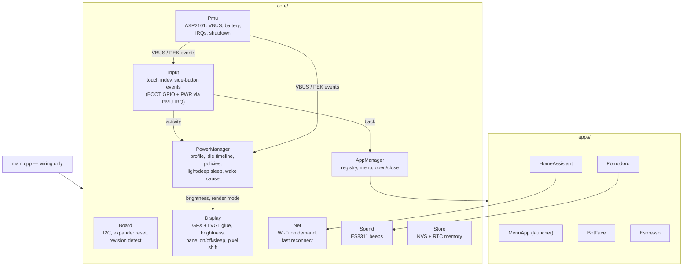
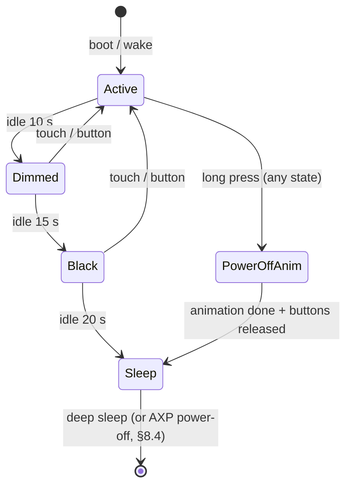

# Architecture

> **Status: implemented, not yet verified on hardware** (see
> [ROADMAP.md](ROADMAP.md)). Where the code differs from the original plan,
> the section says so ("*Implemented:*"); update this file whenever the
> design changes. Per-app specs live in
> [docs/apps/](apps/README.md). Open questions are collected at the end.

## 1. Goals

1. An **app menu** for 10+ apps: round icons in pairs, scrolling vertically.
   Tap an icon to open the app. Two side buttons, like a modern smartwatch:
   one goes **back** one step, the other goes **home** to the menu.
2. Apps (first set, each specified in `docs/apps/`):
   - [Home Assistant lights](apps/home-assistant.md): 2×2 grid toggling 4 lights on the LAN
   - [Bot face](apps/bot-face.md): animated smiley face
   - [Pomodoro](apps/pomodoro.md): focus/break timer that keeps the screen on at minimal power
   - [Espresso shot timer](apps/espresso-timer.md): stopwatch for espresso shots
   - [System](apps/system.md): version, battery, Wi-Fi, memory, and **wireless firmware update (OTA)**
3. **Two power profiles:**
   - **On battery** (small ~400 mAh cell): aggressive dim → black → deep sleep.
   - **On charger**: never sleep; protect the AMOLED from burn-in instead
     (brightness ≤ 80 %, no static picture for long).
4. **Side buttons wake the device** from deep sleep. A **long press** plays a
   short power-off animation and puts the device into deep sleep on demand.
5. Adding an app = one folder + one line of registration, no core changes.

### Non-goals (for now)

On-device Wi-Fi setup (credentials come from `secrets.h`),
audio beyond short beeps, settings UI (later app).

## 2. User-facing behaviour

### 2.1 App menu (launcher)

```
┌──────────────────────────┐   368 × 448 portrait, black background
│ 12:34        ▂▄▆  🔋 82% │   status bar (time, Wi-Fi, battery / ⚡)
│                          │
│    ╭─────╮    ╭─────╮    │   round icons, ~130 px diameter,
│    │ 💡  │    │ 🙂  │    │   2 per row, label under each
│    ╰─────╯    ╰─────╯    │
│    Lights     Bot face   │   vertical scroll with snapping to rows,
│                          │   momentum, scrollbar fades out
│    ╭─────╮    ╭─────╮    │
│    │ 🍅  │    │ ☕  │    │   rows scale slightly toward the centre
│    ╰─────╯    ╰─────╯    │   (watch-style fisheye) — optional polish
│   Pomodoro    Espresso   │
│    ╭─────╮    ╭─────╮    │
│    ┆     ┆    ┆     ┆    │   ← next row peeks in, hinting more apps
└──────────────────────────┘
```

- About 2½ rows are visible, so the partial row signals "scroll for more".
- Tap an icon → it scales up briefly → the app opens (zoom/fade transition).
- The order is the registration order in `main.cpp`. A "recently used first"
  order can come later.
- The menu remembers its scroll position.
- *Implemented:* the fisheye fades rows away from the centre (colour opacity
  down to ~60 %) instead of scaling them, which would need a layer per row;
  a tap shrinks the disc while pressed, then the app fades in.

### 2.2 Navigation — two side buttons

Like Wear OS and similar watches: one button is **Back**, the other **Home**.

| Button | Role | Signal path |
| --- | --- | --- |
| **BOOT** (GPIO0) | **Back** — one step back | GPIO, debounced in firmware |
| **PWR** (AXP2101 PEK) | **Home** — straight to the menu | PMU short/long-press IRQ via EXIO5 |

The mapping is a config swap (`BUTTON_BACK_IS_BOOT`) once we know which one
is physically on top; see §12.

| Input | Effect |
| --- | --- |
| Tap icon in the menu | open the app |
| **Back, short press** | the app handles it first (`onBack()`: close a dialog, leave a sub-screen, …); if the app has nothing to go back to → menu. In the menu: scroll to top. |
| **Home, short press** | always → menu (scroll to top if already there) |
| **Either button, long press (≥ `BUTTON_LONG_PRESS_MS`, 1 s)** | **power-off animation → deep sleep** (§8.3) |
| PWR held ~6 s | hardware power-off by the AXP2101 (firmware can't block it; the sleep animation finishes long before that) |
| Any button / touch while dimmed or black | wake the screen only; the touch is swallowed |
| Any side button while in deep sleep | wake up → **always the menu** (§8.4) |

"Home" can never be overridden by an app, so no app can trap the user.

### 2.3 Visual rules (AMOLED)

On AMOLED a black pixel is off: it costs no power and doesn't wear.

- Black backgrounds everywhere. Colour goes on the content, never on full-screen fills.
- Large bright areas only briefly (e.g. a light tile that is ON uses a warm
  colour fill, but only while the HA app is open).
- Static elements (status bar, labels) are subject to **pixel shift** (§7).

## 3. Power profiles

The **PowerManager** picks a profile from the AXP2101: `isVbusIn()` →
**Charger**, otherwise **Battery**. VBUS insert/remove IRQs switch profiles
live.

| | Battery | Charger |
| --- | --- | --- |
| Max brightness | 100 % (`BRIGHTNESS_MAX_BATTERY`) | **80 %** (`BRIGHTNESS_MAX_CHARGER`) |
| Idle → dim | 10 s → 25 % | 60 s → 40 % |
| Idle → black | 15 s | **5 min → plain black** (display off; touch/button restores, §7) |
| Idle → deep sleep | 20 s | never |
| Wi-Fi | only while an app needs it | can stay connected |
| Pixel shift | yes | yes |

All numbers live in `config.h` (§9).

### 3.1 Per-app power policy

Each app declares how it interacts with the idle timeline:

| Policy | Meaning | Used by |
| --- | --- | --- |
| `Normal` | follow the profile's dim → black → sleep timeline | menu, Home Assistant, bot face |
| `KeepAwake` | full UI stays on while the app says it's busy | espresso timer *while running* |
| `LowPowerDisplay` | never deep sleep; after the dim timeout switch to the app's **minimal render mode** (few dim pixels, rare refresh, CPU light-sleeps between refreshes) | pomodoro *while a timer runs* |

A policy can change at runtime (`setPowerPolicy()`), e.g. the espresso timer
becomes `KeepAwake` only while the stopwatch runs.

**Policies beat profiles.** A non-`Normal` policy behaves the same on the
charger as on battery. A running pomodoro switches to its minimal view after
the *battery* dim delay even while charging; the charger profile only keeps
its 80 % brightness cap. The charger timeline (dim → plain black) applies
only to `Normal` apps.

## 4. Hardware used

| Part | Use | Notes |
| --- | --- | --- |
| CO5300 AMOLED (QSPI) | UI | brightness cmd `0x51`; display off `0x28` / on `0x29`; sleep-in `0x10` / out `0x11`; partial updates must be **even-aligned** (x1, y1 even; x2, y2 odd); the panel keeps its image in its own RAM, so the ESP can light-sleep while it stays on |
| CST820 touch (I2C `0x15`, INT GPIO21) | input | LVGL pointer device; INT is an RTC GPIO → light-sleep wake source |
| TCA9554 (I2C `0x20`) | LCD/touch reset EXIO0–2, PWR key EXIO4, PMU IRQ EXIO5 | reset pulse at every boot, including wake |
| BOOT button (GPIO0) | side button **Back**, wake, long-press sleep | RTC GPIO → deep-sleep wake via ext1 (active low) |
| PWR button (AXP2101 PEK) | side button **Home**, wake, long-press sleep; 6 s hold = hardware off | short/long-press IRQs via EXIO5; deep-sleep wake path: §8.4 |
| AXP2101 PMU | VBUS detect, charging, battery %, power-off/on | XPowersLib: `isVbusIn()`, `isCharging()`, `getBatteryPercent()`, `shutdown()`, VBUS insert/remove + PEK IRQs |
| ES8311 + speaker amp (PA GPIO46) | short beeps (pomodoro phase end) | amp off except while beeping |
| QMI8658 IMU | later: shake/tilt for bot face, pump-vibration auto-start for espresso | optional |
| PCF85063 RTC | wall clock in the status bar | keeps time through deep sleep and AXP power-off |
| ESP32-S3 Wi-Fi | Home Assistant | station mode, only when needed on battery |

## 5. Software stack

Full list with versions, licences and the options we rejected:
[LIBRARIES.md](LIBRARIES.md). Design system, fonts, images, sprites and the
asset pipeline: [UI_DESIGN.md](UI_DESIGN.md).

| Layer | Choice |
| --- | --- |
| Framework | Arduino core 3.x (pioarduino), ESP-IDF APIs where needed (sleep, PM, esp_lcd) |
| UI | **LVGL 9.6**, rendering `RGB565_SWAPPED`, partial mode, 2 DMA buffers |
| Display | **esp_lcd** QSPI panel IO (async DMA) + vendored SH8601/CO5300 panel driver |
| Touch / IMU / RTC | SensorLib |
| PMU | XPowersLib |
| IO expander | own TCA9554 driver |
| Audio | vendored Espressif es8311 + core `ESP_I2S` |
| Network / data | core `WiFi`, `HTTPClient`, ArduinoJson 7 |
| Storage | `Preferences` (NVS), `LittleFS`, `RTC_DATA_ATTR` |
| Assets | `assets/` sources → `tools/assets.py` (lv_font_conv + LVGLImage.py) → `src/ui/generated/` |

## 6. Core services



Rules:

- Services don't know about specific apps; apps use services through small
  interfaces.
- Only the LVGL/UI task touches LVGL objects. Network and other slow work run
  in their own FreeRTOS tasks and report back through queues.

### 6.1 App interface

```cpp
// src/apps/app.h — sketch, final signatures may change
enum class PowerPolicy { Normal, KeepAwake, LowPowerDisplay };

struct AppInfo {
  const char *id;                 // stable key for NVS/RTC ("pomodoro")
  const char *name;               // label in the menu
  const lv_image_dsc_t *icon;     // round icon art (~130 px)
  lv_color_t accent;              // icon ring / app accent colour
};

class App {
 public:
  virtual const AppInfo &info() const = 0;
  virtual void onCreate(lv_obj_t *screen) = 0;  // build widgets once
  virtual void onResume() {}                    // became visible (incl. after wake)
  virtual void onPause() {}                     // leaving: stop timers/requests
  virtual void onTick(uint32_t nowMs) {}        // from the UI loop while visible
  virtual bool onBack() { return false; }       // Back button: true = handled in-app,
                                                // false = AppManager returns to the menu
  virtual PowerPolicy powerPolicy() const { return PowerPolicy::Normal; }
  // LowPowerDisplay apps: switch to / leave the minimal render mode and say
  // when the next refresh is due (the CPU light-sleeps until then).
  virtual void enterMinimalMode() {}
  virtual void exitMinimalMode() {}
  virtual uint32_t nextMinimalRefreshMs() const { return 60000; }
  // Persist across deep sleep / power-off (small, POD).
  virtual size_t saveState(void *buf, size_t cap) { return 0; }
  virtual void restoreState(const void *buf, size_t len) {}
  virtual ~App() = default;
};
```

`AppManager` owns the registered apps (static instances in `main.cpp`). It
creates each app's LVGL screen on first open, switches screens with an
animation, and only keeps the menu plus the current app in memory (other
screens are deleted on pause to save RAM, opt-out per app).

### 6.2 File layout

```
src/
├── main.cpp           wiring: bring-up order in setup(), servicing in loop()
├── core/              board_init (I2C, TCA9554, revision), i2c_bus, display,
│                      touch, buttons, pmu, power, net, ota, sound, rtc_clock,
│                      store, events
├── apps/
│   ├── app.h, app_manager.{h,cpp}
│   ├── menu/             launcher
│   ├── home_assistant/   ha_app, ha_client (FreeRTOS task)
│   ├── bot_face/
│   ├── pomodoro/
│   ├── espresso/
│   ├── dice/             wireframe dice roller
│   └── system/           info + wireless update
└── ui/
    ├── theme.{h,cpp}     design tokens and shared widgets
    ├── power_anim.{h,cpp} power-off / power-on animation
    └── generated/        fonts + icon codepoints from tools/assets.py (committed)
include/   board.h  config.h  secrets.example.h  lv_conf.h
lib/       Arduino-free logic (host-testable):
           PowerFsm/  ButtonLogic/  PomodoroCore/  ShotTimer/  BotFace/  HaParse/  PixelShift/  DiceCore/
test/      Unity tests for lib/ (run with `pio test -e native`)
assets/    asset sources + assets.toml        (UI_DESIGN.md §7)
tools/     assets.py, version.py, size_check.py, sim/ (PC simulator + screenshots)
docs/apps/ one spec per app
```

*Implemented:* the panel commands and the ES8311 setup are small ports inside
`src/core/` rather than vendored libraries; there is no `data/` (LittleFS)
content yet.

### 6.3 Runtime model

**Tasks**

| Task | Core | Priority | Owns |
| --- | --- | --- | --- |
| UI (Arduino `loop()`) | 1 | normal | LVGL (only task calling `lv_*`), AppManager, PowerManager, input polling |
| Net | 0 | normal | Wi-Fi state machine, SNTP |
| HA client | 0 | low | HTTP requests (spawned by the HA app) |
| Sound | 0 | high, short-lived | I2S beep playback |

LVGL runs with `LV_OS_NONE`. Concurrency safety comes from ownership, not
locks: other tasks never touch UI objects.

**Event bus.** Cross-task and cross-module communication goes through one
FreeRTOS queue of small typed events, drained by the UI task once per frame
and dispatched to services and the current app:

```cpp
enum class Ev : uint8_t { BackPressed, HomePressed, LongPress, Touch,
                          VbusChanged, BatteryLevel, WifiState, HaResult,
                          TimerDue, ... };
struct Event { Ev type; uint32_t a; uint32_t b; void *ptr; };  // ptr: owned by receiver
bool events::post(const Event &e);            // any task, ISR-safe variant too
```

ISRs (button GPIO, PMU IRQ) only set flags or post events; the I2C work they
trigger runs in the UI task.

**I2C.** One bus with 7 devices. Every access goes through
`I2cBus::lock()` (FreeRTOS mutex). In practice almost all I2C traffic (touch,
PMU, RTC, expander) comes from the UI task.

**Memory.**

| What | Where |
| --- | --- |
| LVGL draw buffers (2 × ~29 KB) | internal DMA RAM |
| LVGL heap (widgets, styles), image cache | PSRAM |
| Network buffers, JSON documents | PSRAM (`ArduinoJson` custom allocator) |
| Fonts, images, sprites | flash (memory-mapped) |
| Stack sizes | UI 16 KB, Net 8 KB, HA 8 KB |

No allocation in per-frame paths; apps are static objects; screens are
created on open and deleted on close.

**Time.** The PCF85063 RTC is the clock source (it survives sleep and
power-off). When Wi-Fi is up, SNTP corrects it. Timezone is a POSIX TZ
string in `config.h` (`TIMEZONE`, e.g. `"CET-1CEST,M3.5.0,M10.5.0/3"`).

**Settings.** Compile-time defaults in `config.h`. A `Settings` service reads
NVS overrides on top of them (written by a future Settings app), so apps read
settings through `Settings`, never directly from macros. *Not implemented
yet:* with no Settings app there is nothing to override, so apps read
`config.h` directly for now; add the service together with the app.

**Conventions.** C++17, one namespace per area (`core::`, `apps::`, `ui::`),
`.clang-format` (Google style: 2-space indent, 120 columns), no exceptions in firmware code, `ESP_LOGx` with a per-module tag.


## 7. AMOLED burn-in protection

These apply in both profiles. They matter most on the charger, where the
screen is on for hours.

1. **Brightness cap:** 80 % on the charger, configurable.
2. **Pixel shift:** every `PIXEL_SHIFT_PERIOD_MS` (default 3 min) the whole UI
   shifts by up to ±`PIXEL_SHIFT_MAX_PX` (default 4 px), along a slow
   Lissajous path so it never returns to the same spot on a regular beat.
   Implemented in the display driver: on each shift the whole screen is
   invalidated and the flush draws at the new offset, so apps don't have to
   care. Layouts keep a 4 px black safe margin on every edge.
3. **Plain black after 5 min idle on the charger** (`Normal` apps): the
   panel's display-off command, so every pixel is off. A touch or button
   brings back the previous screen.
4. **Minimal render modes** (pomodoro) use thin, dim elements, a ring rather
   than filled shapes, and also drift.
5. No app may show a full-screen bright fill for more than a few seconds.

## 8. Sleep, wake and persistence

### 8.1 Battery idle timeline (policy `Normal`)



Brightness changes fade over ~300 ms. "Black" is brightness 0 with the panel
on, so a touch restores the picture instantly.

### 8.2 `LowPowerDisplay` (pomodoro)

Active → (dim timeout) → **Minimal**: the app redraws a sparse, dim view;
Wi-Fi off; LVGL refreshes only when `nextMinimalRefreshMs()` is due; between
refreshes the ESP32-S3 enters **light sleep**. The panel keeps showing its
last frame from its own RAM. Wake sources during light sleep: timer
(next refresh), touch INT (GPIO21), BOOT (GPIO0), PMU IRQ path.
A touch/button returns to the full view.

### 8.3 Deep sleep entry

There are two triggers: the battery idle timeline (§8.1), or a **long press on
either side button** (any profile, even on the charger, and even while an
app holds `KeepAwake`/`LowPowerDisplay`, because the user asked for it).

**Power-off animation (long press only), ~1 s:** the current screen shrinks
into a horizontal line, which collapses to a dot and fades out (CRT
switch-off style), while the brightness ramps down. It confirms the action
and gives the user time to let go, so the still-held button doesn't wake
the device straight away. The sequence doesn't continue until all buttons
read released (with a 3 s safety timeout; if one is still held, show
"release button" and keep waiting).

Sequence:

1. Current app `onPause()` + `saveState()` (e.g. pomodoro saves as paused);
   save `RtcState`.
2. Wi-Fi off. Speaker amp off.
3. Panel: brightness 0 → display off (`0x28`) → sleep-in (`0x10`); touch IC to sleep.
4. Arm the wake sources (§8.4), confirm the buttons are released,
   `esp_deep_sleep_start()`.

Wake = reboot: `setup()` checks `esp_sleep_get_wakeup_cause()`, re-runs the
expander reset + panel init and **opens the menu**. Apps restore their saved
state when they're next opened. Target: menu visible < 500 ms after the
press, with a short power-on animation (the dot expands into the screen).

### 8.4 Waking with the side buttons

| Button | Path | Confidence |
| --- | --- | --- |
| BOOT (GPIO0) | ESP32-S3 deep sleep, `esp_sleep_enable_ext1_wakeup(1ULL << 0, ESP_EXT1_WAKEUP_ANY_LOW)` | high — GPIO0 is an RTC GPIO. Verify that holding it through the wake doesn't enter download mode (strapping pin). |
| PWR (AXP2101) | Option A: PEK IRQ → TCA9554 EXIO5 → TCA9554 INT → an ESP RTC GPIO → ext1 wake. Works only if the expander INT line reaches an RTC-capable GPIO — **unknown, no schematic**. Test in M6 by watching all free RTC GPIOs while pressing PWR. | unknown |
| PWR (AXP2101) | ~~Option B~~ (not used, see below): **"deep off"** — instead of ESP deep sleep, call `pmu.shutdown()`. The AXP2101 cuts all rails (lowest drain); pressing PWR powers the board on again (cold boot, `setPowerKeyPressOnTime()` sets the press length). RTC memory is lost, so the state goes to NVS before shutdown; the PCF85063 keeps the time. BOOT can't wake from this. | high (standard AXP behaviour) |

**Decision:** BOOT (ext1) is the wake button; one wake button is enough
(owner, 2026-10-09). In M6 we still try Option A, and if PWR can wake too,
that's a bonus. If it can't, PWR simply doesn't wake the device. Option B
(AXP power-off) isn't built. Record the outcome in HARDWARE.md and LESSONS.md.

### 8.5 Persistence

| What | Where | Survives |
| --- | --- | --- |
| Wi-Fi channel/BSSID, cached HA states, app `saveState()` blobs | `RTC_DATA_ATTR RtcState` | deep sleep |
| same, written on "deep off" / power-off | NVS (`Store`) | power-off |
| espresso shot history, pomodoro counters/settings | NVS | power-off |

NVS writes happen only on sleep/shutdown or on user actions, never
periodically (flash wear).

## 9. Configuration

`include/config.h` (committed) — sketch:

```cpp
// ---- power profiles ----
#define BRIGHTNESS_MAX_BATTERY     255
#define BRIGHTNESS_MAX_CHARGER     204   // 80 %
#define BRIGHTNESS_DIM_BATTERY     64    // 25 %
#define BRIGHTNESS_DIM_CHARGER     102   // 40 %
#define BRIGHTNESS_FADE_MS         300
#define BAT_IDLE_DIM_MS            10000
#define BAT_IDLE_BLACK_MS          15000
#define BAT_IDLE_SLEEP_MS          20000
#define CHG_IDLE_DIM_MS            60000
#define CHG_IDLE_BLACK_MS          300000   // plain black (display off)
// ---- buttons ----
#define BUTTON_BACK_IS_BOOT        1     // 1: BOOT = back, PWR = home; 0: swapped
// ---- OTA (§12) ----
#define OTA_HOSTNAME               "esp32-amoled"
#define OTA_MIN_BATTERY_PCT        30
#define OTA_HEALTHY_AFTER_MS       10000
#define BUTTON_LONG_PRESS_MS       1000  // long press → power-off animation → deep sleep
#define POWER_OFF_ANIM_MS          1000
// ---- burn-in ----
#define PIXEL_SHIFT_PERIOD_MS      180000
#define PIXEL_SHIFT_MAX_PX         4
// ---- apps ----  (each app's own block, see docs/apps/*.md)
```

`include/secrets.h` (gitignored) gains `HA_BASE_URL`, `HA_TOKEN` and
optional static-IP fields. Placeholders go in `secrets.example.h`.

## 10. Error handling & logging

- Every module logs through `ESP_LOGx(TAG, …)` with a per-module tag
  (`board`, `display`, `power`, `ha`, …); the level comes from
  `CORE_DEBUG_LEVEL` (release: errors only, debug: verbose).
- Missing peripherals (touch, IMU, codec) → log and continue without that
  feature. Only a missing display is fatal.
- App-specific failures are described in each app spec.

## 11. Testing

- **CI:** both firmware environments build (size budget enforced by
  `tools/size_check.py`), host tests and the simulator flow test run, and the
  generated assets are checked against their sources.
- **Host tests (`[env:native]` + Unity, `test/`):** pure logic lives in
  Arduino-free libraries under `lib/` (`PowerFsm`, `PomodoroCore`, `BotFace`,
  `ShotTimer`, `HaParse`), so it compiles and runs on the PC. Adapters in
  `src/` connect them to hardware and LVGL. CI runs these tests next to the
  firmware builds.
- **Simulator (`[env:sim]`, `tools/sim/`):** the real apps, UI and LVGL run
  on the PC against stubbed hardware modules; `sim_main.cpp` taps through
  every app, checks the results and writes frames that `tools/sim/shots.py`
  turns into `docs/design/screens/` + `firmware-screens.png`.
- **On hardware:** each milestone's checklist in ROADMAP.md, run by the
  owner (agents can't flash). Measured currents and timings go into
  HARDWARE.md.

## 12. Firmware updates over Wi-Fi (OTA)

### 12.1 Does it fit?

Yes, by design. `partitions.csv` already has **two 4 MB app slots**
(`app0`/`app1`) plus `otadata`: the new image is written to the inactive slot
while the old one keeps running, then the bootloader switches over.

| Budget | Limit | Enforced by |
| --- | --- | --- |
| Firmware image | **≤ 3.0 MB** target (warn), **3.5 MB** hard limit (fail) of the 4 MB slot | CI size check on `firmware.bin` |
| Today (skeleton) | 0.3 MB | — |
| Expected with LVGL, fonts, Wi-Fi/HTTP, apps | ~1.5–2.5 MB | measured each milestone, noted in the PR |

If the budget gets tight: move big images/sprites to LittleFS (UI_DESIGN §7),
subset fonts harder, or drop unused LVGL widgets in `lv_conf.h`. Changing the
partition table would need one USB flash, so it's the last resort.

### 12.2 How an update is delivered

**v1 — push from the PC (ArduinoOTA / espota):**

- On the device: **System → Wireless update** turns Wi-Fi on, takes a
  `KeepAwake` lock (no dimming or sleep), starts the OTA listener with mDNS
  name `esp32-amoled.local`, and shows host, IP and version.
- On the PC: VS Code task **"ESP: upload OTA"** →
  `pio run -e amoled-ota -t upload` (env with `upload_protocol = espota`,
  `upload_port = esp32-amoled.local`). The password comes from the
  `ESP_OTA_PASSWORD` environment variable on the PC and must match
  `OTA_PASSWORD` in `secrets.h`. It's never written into `platformio.ini`.
- During the update the screen shows a progress ring and "Don't power off";
  touch and buttons are ignored except Home, which cancels before the transfer
  starts.
- The LittleFS image (`data/`) can be pushed the same way
  (`-t uploadfs` on the OTA env).
- The listener runs **only** while the update screen is open (owner's
  choice); there's no background listening, even on the charger.

**Later — pull from GitHub Releases:** CI attaches `firmware.bin` and a
`version.json` to tagged releases; System → "Check for updates" downloads
over HTTPS (core `HTTPUpdate`, certificate bundle) when a newer version
exists. Needs the repo releases to be reachable without auth.

### 12.3 Safety

| Risk | Protection |
| --- | --- |
| Bad firmware boots and crashes / hangs | **Rollback.** The Arduino core ships its bootloader with `CONFIG_BOOTLOADER_APP_ROLLBACK_ENABLE=1`. We override the core's weak `verifyRollbackLater()` to return `true`, then mark the image valid (`esp_ota_mark_app_valid_cancel_rollback()`) only after a **health check**: display + touch initialised, menu rendered, 10 s without a reset. A crash or watchdog reset before that → the bootloader boots the previous slot. |
| Power loss mid-transfer | the old slot stays active until the new image is complete and verified (SHA-256 check by the OTA library) |
| Flat battery during update | listener refuses to start below **30 %** unless on the charger |
| Someone else on the LAN flashes it | listener runs only while the update screen is open; password required; never enabled when `OTA_PASSWORD` is empty |
| Wrong board / wrong project image | image `project_name` must match (`esp_app_desc_t`), checked in `onStart`. *Not implemented yet:* ArduinoOTA's `onStart` sees no image header; needs a check on the first chunk (or HTTP update) — rollback still covers an image that doesn't boot. |

### 12.4 Versioning

A pre-build script `tools/version.py` sets `APP_VERSION` from
`git describe --tags --dirty` (e.g. `v0.3.0-5-gabc123`), replacing the
hard-coded value in `config.h`. The version is shown in the System app and the
update screen, logged at boot, and embedded in `esp_app_desc_t`.

## 13. Open questions

None right now. All answers are recorded in DECISIONS.md (2026-10-09):
back + home buttons like a smartwatch (BOOT = Back, PWR = Home); wake →
always the menu; battery dim level 25 %; portrait orientation; board is V2;
long press → animation → deep sleep; BOOT alone is enough as the wake button;
charger: dim at 60 s to 40 %, then plain black; policies like pomodoro behave
the same on the charger as on battery; speaker beeps OK; OTA only from the
update screen.

New questions found during implementation go here.

- Does the CST820 keep INT low while a finger rests (it would keep waking
  light sleep in the pomodoro minimal view)? Check in M10.
- Is plain-http Home Assistant on the LAN acceptable long term, or should the
  client get TLS (`WiFiClientSecure`, ~+40 KB)?
