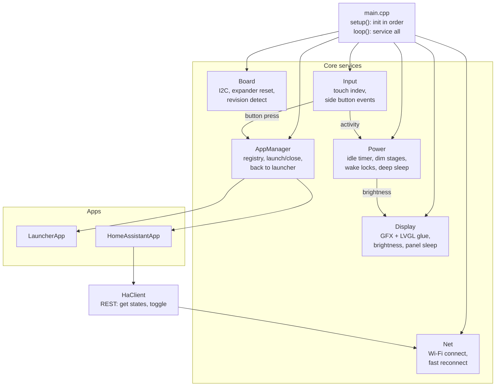
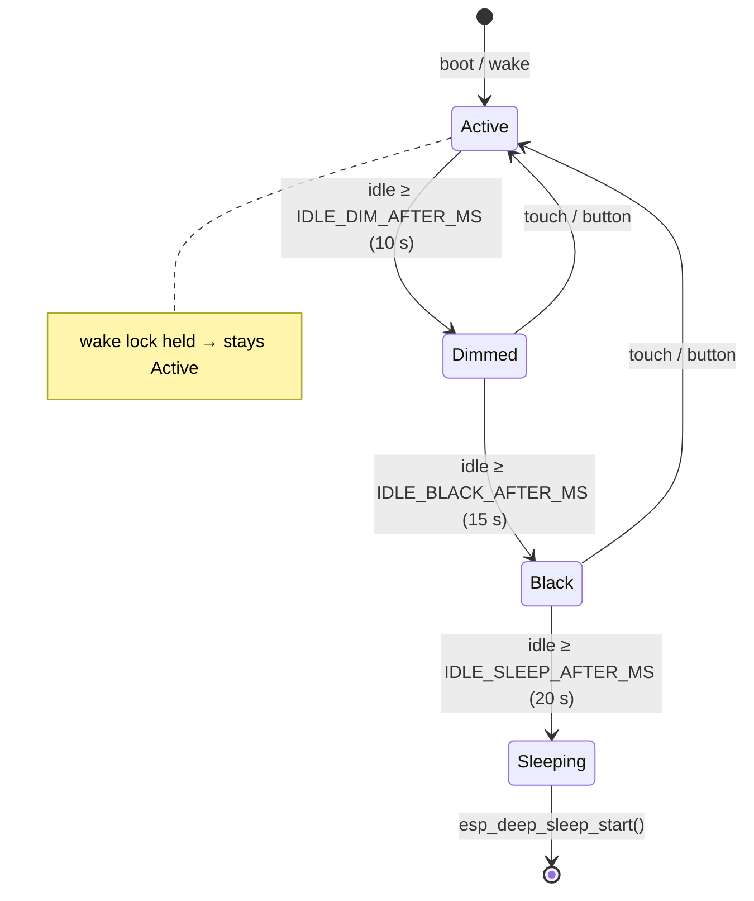

# Architecture — app launcher + Home Assistant lights

> **Status: plan, not implemented yet.** This document is the design we build
> against. Implementation follows [ROADMAP.md](ROADMAP.md) milestone by
> milestone; update this file whenever the design changes. Open questions are
> collected at the end.

## 1. Goals

1. A small **app launcher**: a home screen of app icons; tapping one opens the
   app. More apps get added over time without touching the core.
2. A **side button** brings up the launcher from anywhere (and wakes the device).
3. First app — **Home Assistant lights**: a 2×2 grid of four preconfigured
   lights on the local network; tap a tile to toggle that light.
4. **Battery-friendly**: after a short idle period the screen dims, goes black,
   then the device enters **deep sleep**; the side button wakes it.

### Non-goals (for now)

- Brightness/colour control, scenes, more than 4 lights (later iterations).
- Wi-Fi provisioning on the device (credentials come from `secrets.h`).
- OTA updates, clock/watch face, sensors, audio.

## 2. User-facing behaviour

### Screens

```
 Launcher (home)                 Home Assistant app
┌──────────────────────┐        ┌──────────┬───────────┐
│ 12:34      Wi-Fi ▂▄▆ │        │  💡      │  💡       │
│                      │        │ Living   │ Kitchen   │
│  ┌────┐    ┌────┐    │  tap   │  room    │           │
│  │ 💡 │    │ ⚙  │    │ ─────► │   ON     │   OFF     │
│  │    │    │    │    │        ├──────────┼───────────┤
│  └────┘    └────┘    │        │  💡      │  💡       │
│  Lights    Settings  │        │ Bedroom  │ Hallway   │
│                      │        │          │           │
│                      │        │   OFF    │  ??? (n/a)│
└──────────────────────┘        └──────────┴───────────┘
   368 × 448 portrait              four 184 × 224 tiles
```

- **Launcher:** grid of app tiles (icon + name), 2 columns, scrolls when more
  apps exist. Status bar: Wi-Fi state, later battery and time. *Settings* is
  shown only to illustrate a second app; it is a later milestone.
- **Home Assistant app:** the whole screen is a 2×2 grid. Each tile shows the
  configured label, a bulb icon, and the state:

  | State | Tile look |
  | --- | --- |
  | on | warm yellow fill, dark text |
  | off | dark grey fill, light text |
  | pending (toggle sent, no confirmation yet) | current colour + spinner |
  | unavailable / unknown / error | outlined, dimmed, "n/a" |
  | stale (cached from before sleep, not refreshed yet) | normal colours + small "…" marker |

  Tap → toggle. The tile changes to *pending* immediately, then to the state
  Home Assistant confirms.

### Side button

| Context | Short press |
| --- | --- |
| Deep sleep | wake up → previous app (see §6.4) |
| Screen dimmed / black | restore full brightness, nothing else |
| Inside an app | close the app → launcher |
| Launcher | nothing (already home) |

Long press is reserved for later (e.g. power menu). Holding PWR ~6 s is a
hardware power-off by the AXP2101 regardless of firmware.

### Idle → sleep timeline

Any touch or button press resets the timer to 0.

```
 t = 0 s         10 s          15 s          20 s
 │── full ───────│── dimmed ───│── black ────│→ deep sleep
   brightness       brightness    brightness
   100 %            ~25 %         0 % (panel on)
```

- **Dimmed / black:** the UI keeps running, so a touch instantly restores full
  brightness. The touch that wakes the screen is **swallowed**, so it can't
  accidentally toggle a light.
- **Deep sleep:** panel and touch are put to sleep, Wi-Fi off, ESP32-S3 in
  deep sleep. Only the side button wakes it.
- All durations and the dim level are in `config.h` (§8).
- Apps can hold a wake lock (e.g. a future timer app), keeping the device
  awake. The HA app doesn't need one.

## 3. Hardware used

| Part | Use | Notes |
| --- | --- | --- |
| CO5300 AMOLED (QSPI) | UI | brightness via cmd `0x51`; sleep-in `0x10` / sleep-out `0x11`; partial updates must be **even-aligned** (x1, y1 even; x2, y2 odd) |
| CST820 touch (I2C `0x15`, INT GPIO21) | input | polled through LVGL input driver; INT optional |
| TCA9554 expander (I2C `0x20`) | LCD/touch reset (EXIO0–2) | must pulse at every boot, including wake from deep sleep |
| BOOT button (GPIO0) | side button candidate | RTC-capable GPIO → can wake from deep sleep (ext1, active low) |
| PWR button (AXP2101) | side button candidate | readable only through the PMU IRQ (I2C / EXIO5) — wake from deep sleep not confirmed, see §11 |
| AXP2101 PMU | battery level (later), rails | keep display rail on in deep sleep at first; optimise later |
| ESP32-S3 Wi-Fi | Home Assistant | station mode |

## 4. Software stack

| Layer | Choice | Why |
| --- | --- | --- |
| Framework | Arduino core 3.x (pioarduino) | already set up; IDF APIs available for sleep/Wi-Fi tuning |
| Display driver | GFX Library for Arduino — `Arduino_ESP32QSPI` + `Arduino_CO5300` | what Waveshare's own examples use for both revisions |
| UI | **LVGL 9.x** | widgets, styles, animations, input handling; vendor BSP targets v9 |
| Touch | SensorLib `TouchDrvCSTXXX` (V2) / FT3168 driver (V1) | registry library, pinned version |
| IO expander | Adafruit XCA9554 | vendor-proven |
| PMU | XPowersLib | PWR key IRQ, battery voltage later |
| HTTP / JSON | `HTTPClient` (core) + ArduinoJson 7 | Home Assistant REST API |

LVGL draw buffers: two partial buffers of 368 × 45 lines × 2 B ≈ 33 KB each in
PSRAM (DMA-capable internal RAM is the fallback if PSRAM flushes are too slow).
Colour depth 16-bit RGB565, byte-swapped for the QSPI bus.

## 5. Module architecture



Rule: services don't know about specific apps; apps talk to services through
small interfaces. `main.cpp` only wires things together (AGENTS.md).

### Planned file layout

```
src/
├── main.cpp                  wiring only
├── core/
│   ├── board.{h,cpp}         Wire init, TCA9554 reset pulse, revision detect
│   ├── display.{h,cpp}       Arduino_GFX + LVGL display driver, rounder, brightness, sleep
│   ├── input.{h,cpp}         LVGL touch indev, button debounce → events
│   ├── power.{h,cpp}         idle state machine, wake locks, deep sleep entry, wake cause
│   ├── net.{h,cpp}           Wi-Fi state machine, cached channel/BSSID
│   └── app_manager.{h,cpp}   app registry, current app, transitions
├── apps/
│   ├── app.h                 App interface
│   ├── launcher_app.{h,cpp}
│   └── home_assistant/
│       ├── ha_app.{h,cpp}    2×2 tile UI
│       └── ha_client.{h,cpp} REST calls, JSON parsing
└── ui/
    ├── theme.{h,cpp}         colours, fonts, shared styles
    └── assets/               icons (C arrays generated by LVGL image converter)
include/
├── board.h  config.h  secrets.example.h  lv_conf.h
```

### App interface

```cpp
// src/apps/app.h — sketch, final signatures may change
class App {
 public:
  virtual const char *name() const = 0;          // shown in the launcher
  virtual const lv_image_dsc_t *icon() const = 0;
  virtual void onCreate(lv_obj_t *screen) = 0;   // build widgets on a fresh screen
  virtual void onResume() {}                     // became visible (incl. after wake)
  virtual void onPause() {}                      // leaving: stop timers, requests
  virtual void onTick(uint32_t nowMs) {}         // called from loop() while visible
  virtual bool wantsWakeLock() const { return false; }
  virtual ~App() = default;
};
```

`AppManager` owns a static list of apps (registered in `main.cpp`), creates
each app's LVGL screen lazily on first open, and switches with
`lv_screen_load_anim()`. Only one app is "resumed" at a time. The launcher is
app #0 and is never destroyed.

## 6. Power management

### 6.1 State machine



Brightness changes fade over ~300 ms (LVGL anim on the brightness value) so
the transitions don't look like flicker.

### 6.2 Entering deep sleep

1. Current app `onPause()`; save `RtcState` (§6.4).
2. Wi-Fi disconnect + `WiFi.mode(WIFI_OFF)`.
3. Panel: brightness 0 → display off (`0x28`) → sleep-in (`0x10`).
4. Touch controller → sleep mode (I2C command), so INT stays quiet.
5. Configure wake source: `esp_sleep_enable_ext1_wakeup(1ULL << PIN_BOOT_BUTTON, ESP_EXT1_WAKEUP_ANY_LOW)`
   (exact API depends on side-button choice, §11).
6. Wait for the button to be released (avoid instant wake), then
   `esp_deep_sleep_start()`.

### 6.3 Waking up

Deep-sleep wake is a reboot: `setup()` runs again. `esp_sleep_get_wakeup_cause()`
tells a wake from a cold boot.

Target: **first frame < 500 ms, fresh light states < 1.5 s** after the press.

1. Board init + expander reset pulse (the panel needs re-init after sleep).
2. Display + LVGL init, restore last app from `RtcState`, render cached states
   marked *stale* — the user sees the tiles immediately.
3. Wi-Fi fast reconnect using cached channel + BSSID (+ optional static IP),
   in the background.
4. Once connected: HA app refreshes all four states; tiles drop the *stale*
   marker.

### 6.4 RTC memory (survives deep sleep, lost on power-off)

```cpp
struct RtcState {            // RTC_DATA_ATTR
  uint32_t magic;            // validity check
  uint8_t  lastAppIndex;     // reopen the same app after wake
  uint8_t  wifiChannel;
  uint8_t  wifiBssid[6];
  int8_t   lightState[4];    // -1 unknown, 0 off, 1 on (rendered as stale)
};
```

### 6.5 Open power topics (later milestones)

- Measure deep-sleep current; if the AMOLED rail draws too much, switch it off
  through the AXP2101 and accept a longer wake.
- Battery percentage in the status bar (AXP2101 fuel gauge).
- Wake-on-touch (GPIO21 is RTC-capable) — needs the touch IC to stay in a
  gesture-wake mode.

## 7. Home Assistant integration

### 7.1 API

Home Assistant REST API over plain HTTP on the LAN
(`http://<host>:8123`), authenticated with a **long-lived access token**
(HA → Profile → Security → Long-lived access tokens).

| Action | Request |
| --- | --- |
| Read one light | `GET /api/states/light.living_room` → `{"state":"on", ...}` |
| Toggle | `POST /api/services/light/toggle` body `{"entity_id":"light.living_room"}` |
| (later) Set brightness | `POST /api/services/light/turn_on` body `{"entity_id":..., "brightness_pct": 40}` |

Headers: `Authorization: Bearer <token>`, `Content-Type: application/json`.

### 7.2 Behaviour

- On resume / after Wi-Fi connects: fetch the 4 states (sequential, one
  keep-alive connection, 1.5 s timeout each).
- While the app is visible: poll every `HA_POLL_MS` (default 3 s) so changes
  made elsewhere show up. Device is awake only ~20 s at a time, so polling is
  cheap and simple.
- Toggle: optimistic *pending* state → POST → read the returned state list; if
  the entity isn't in it, follow up with a GET. On failure the tile reverts and
  shows an error flash.
- Network calls must not block LVGL: `HaClient` runs in its own FreeRTOS task
  and talks to the UI through a queue (requests in, results out). The UI
  thread only applies results.

### 7.3 Later: WebSocket API

`ws://<host>:8123/api/websocket` with `subscribe_entities` pushes state
changes instantly instead of polling. Worth it once the device stays awake
longer (e.g. on USB power). Not in the first version.

### 7.4 Security notes

- The token has full admin rights in HA. It lives only in `secrets.h`
  (gitignored) and in flash; anyone with the device can extract it. A
  dedicated HA user for the device keeps the token revocable on its own.
- Plain HTTP is fine on a trusted LAN; HTTPS (with the HA cert pinned) is a
  later option.

## 8. Configuration

`include/config.h` (committed):

```cpp
// --- power / idle ---
#define IDLE_DIM_AFTER_MS     10000
#define IDLE_BLACK_AFTER_MS   15000
#define IDLE_SLEEP_AFTER_MS   20000
#define BRIGHTNESS_FULL       255
#define BRIGHTNESS_DIM        64     // ~25 %
#define BRIGHTNESS_FADE_MS    300

// --- Home Assistant lights (exactly 4, in screen order: TL, TR, BL, BR) ---
#define HA_LIGHTS { \
    {"light.living_room", "Living room"}, \
    {"light.kitchen",     "Kitchen"},     \
    {"light.bedroom",     "Bedroom"},     \
    {"light.hallway",     "Hallway"},     \
}
#define HA_POLL_MS            3000
#define HA_HTTP_TIMEOUT_MS    1500
```

`include/secrets.h` (gitignored), new keys added to `secrets.example.h`:

```cpp
#define WIFI_SSID        "..."
#define WIFI_PASSWORD    "..."
#define HA_BASE_URL      "http://192.168.1.10:8123"
#define HA_TOKEN         "eyJ..."           // long-lived access token
// optional, speeds up wake: leave empty for DHCP
#define WIFI_STATIC_IP   ""
#define WIFI_GATEWAY     ""
#define WIFI_SUBNET      ""
#define WIFI_DNS         ""
```

The HA URL counts as a secret because it's specific to one home.

## 9. Error handling

| Situation | What the user sees |
| --- | --- |
| Wi-Fi can't connect in 8 s | status bar icon crossed out; HA tiles show "no Wi-Fi"; retries in background |
| HA unreachable / timeout | tiles show stale cached state with "…" marker, retry on next poll |
| HTTP 401 | full-width banner "HA token rejected — check secrets.h" |
| Entity not found (404) / `unavailable` | that tile shows "n/a" |
| Touch controller missing at boot | serial log + continue (button still works) |

All failures are logged on serial with a `[module]` prefix (as in
ClaudeObserver).

## 10. Testing approach

- **CI:** both environments must build (unchanged).
- **Host-side unit tests (later):** HA JSON parsing and the power state
  machine are plain logic → testable with PlatformIO `native` env + Unity
  without hardware.
- **On hardware, per milestone:** acceptance checklist in ROADMAP.md.
  Agents can't flash the board; the owner runs the checklist and reports
  results, which go into LESSONS.md when surprising.

## 11. Open questions

1. **Which physical button is "the side button"?** BOOT (GPIO0) or PWR
   (AXP2101)? BOOT can wake from deep sleep directly via ext1. PWR only
   reaches the ESP through the PMU IRQ → TCA9554 EXIO5; whether the expander's
   INT line is wired to an RTC GPIO is unknown (no schematic), so PWR wake
   from deep sleep may be impossible. **Proposal:** BOOT is the
   menu/wake button; PWR stays the hardware power switch. Confirm on the
   device.
2. **Wake target:** reopen the last app (proposed) or always the launcher?
3. **Deep sleep vs. light sleep:** deep sleep (requested) costs a ~1 s
   reconnect on every wake. Light sleep keeps Wi-Fi state and wakes in
   milliseconds but draws more. Plan: deep sleep as specified; revisit
   after measuring.
4. **Dim level:** 25 % proposed for the "reduced brightness" stage.
5. **Orientation:** portrait 368 × 448 proposed (matches the 2×2 grid).
6. **Board revision:** V2 assumed (CO5300/CST820). Confirm the label.
7. **Long press on the side button:** reserve for a future power/settings menu?
