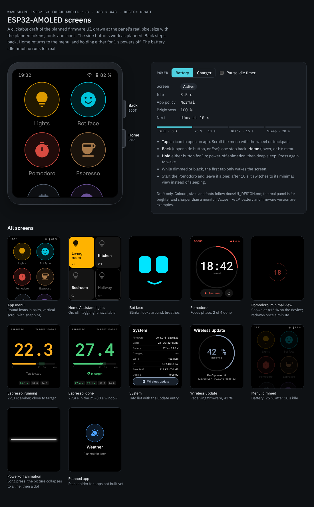

# UI design & assets

> **Status: implemented** (`src/ui/theme.{h,cpp}`, `src/ui/generated/`), not
> yet verified on hardware. The design system all apps share, and where
> images, fonts and sprites live and how they get onto the device. Tokens
> defined here are implemented once in `src/ui/theme.{h,cpp}`. Apps never
> hard-code colours, sizes or durations.

## 0. Mockup

[`docs/design/ui-mockup.html`](design/ui-mockup.html) is a clickable draft of
the launcher and the first apps (Dice and Level are in
[`dice-wireframe.html`](design/dice-wireframe.html) and
[`level.html`](design/level.html)), at the panel's real 368 × 448 size, using these tokens,
fonts and icons. Open it in a browser (it loads fonts from Google Fonts). It
simulates the side buttons (Power: press = screen off, hold = power off;
Back / Home), both power animations and the battery/charger idle timelines.



The mockup is the visual reference for implementation. When a design decision
changes, update the mockup and this document together.

## 1. Canvas

- **368 × 448 px, portrait**, ~1.8", ~330 ppi. A 16 px font is small, so
  text is ≥ 20 px wherever possible.
- **Safe margin 4 px** on every edge (pixel-shift travel, §6). The panel
  corners may be slightly rounded: keep content out of the 24 px corner squares
  (verify the real radius in M1).
- Touch targets **≥ 56 × 56 px**, ≥ 8 px apart (finger on a small screen).
- The menu has a 32 px status bar; apps are full-screen (no status bar) to
  maximise space. Navigation is by the hardware Back/Home buttons, so no
  on-screen back buttons are needed.

## 2. Colour (AMOLED-first)

A black pixel is off: it costs no power and doesn't wear the panel. Backgrounds
are pure black, and colour is spent on content.

| Token | Value | Use |
| --- | --- | --- |
| `bg` | `#000000` | every background |
| `surface` | `#141414` | tiles, cards, pressed states |
| `surface_hi` | `#242424` | raised/selected surface |
| `outline` | `#3A3A3A` | 1–2 px borders, disabled outlines |
| `text` | `#EDEDED` | primary text (not pure white: less glare and wear) |
| `text_dim` | `#9A9A9A` | secondary text, captions |
| `text_off` | `#5A5A5A` | disabled |
| `success` | `#4CD07D` | in target, OK |
| `warning` | `#FFB020` | close to target, stale |
| `error` | `#FF5A5F` | failures, over target |
| `info` | `#4DA3FF` | neutral highlight, "early" |

Per-app **accent** (icon glyph + ring, in-app highlights):

| App | Accent |
| --- | --- |
| Home Assistant lights | `#FFB300` amber |
| Bot face | `#00E5FF` cyan |
| Pomodoro | `#FF5A4E` tomato |
| Espresso | `#C8915A` crema |
| Dice | `#FF8A1F` orange (`DICE_COLOR`) |
| Level | `#FFD54F` yellow (`LEVEL_COLOR`) |
| System | `#8FA3BF` slate |
| Wi-Fi settings, quick settings | `#4DA3FF` (`col::info`) |

New apps pick a hue not already in use. The accent at ~15 % brightness on black
is the "tinted surface" (`accent_dim`, computed by the theme).

## 3. Typography

The fonts are listed in `assets/assets.toml`; each becomes `font_<name>`.

| Font | Family | Size | Use |
| --- | --- | --- | --- |
| `caption` | Inter Medium | 16 | status bar, small labels |
| `list` | Inter Regular | 17 | list rows (System) |
| `body` | Inter Regular | 20 | normal text, menu labels |
| `body_medium` | Inter Medium | 20 | emphasised body text |
| `title` | Inter SemiBold | 28 | screen titles, tile labels |
| `digits_24`, `digits_32` | Roboto Mono Medium | 24, 32 | dice faces, Level readouts |
| `digits_44` | Roboto Mono Medium | 44 | dice faces, pomodoro minimal view |
| `digits_56` | Roboto Mono Medium | 56 | dice, System update progress |
| `digits_80` | Roboto Mono Medium | 80 | pomodoro full view, dice |
| `digits_120` | Roboto Mono Medium | 120 | espresso timer |
| `digits_160` | Roboto Mono Medium | 160 | Timer clock (digits and "-" only) |
| `icon_18`, `icon_28` | Material Symbols Rounded | 18, 28 | status bar, inline icons |
| `icon_56`, `icon_64` | Material Symbols Rounded | 56, 64 | light tiles and System; app icons |

- All fonts are rendered at **4 bpp** (anti-aliased).
- Text fonts include **Latin-1 + Latin Extended-A** (U+0020–007E,
  U+00A0–017F), so Czech labels (ě š č ř ž ý á í é ů ú) render, plus a few
  punctuation marks (– — ’ … − ✓ ✗).
- Digit fonts contain only what their users need, which keeps the big sizes
  small: `digits_24`/`_32` have `0123456789?.%°+ `, `digits_44` has
  `0123456789:.-%? `, `digits_56`/`_80`/`_120` have `0123456789:.-% `; all
  of them also have − (U+2212).
- Every icon font carries the same icon set (the `icons` lists in
  `assets.toml`), so any `ICON_*` macro works at any size.

## 4. Spacing, shape, motion

- **Spacing:** 4 px grid: `4, 8, 12, 16, 24, 32`. Default content padding 16.
  Headers and bottom bars sit 24 px from the side and top edges
  (`ui::kEdge`); bottom bars 20 px from the bottom edge (`ui::kBarBottom`).
  Buttons are 56 px tall, 48 px when a bar holds three controls
  (`ui::kBtn` / `ui::kBtnSmall`).
- **Radius:** tiles 24, cards 16, buttons pill (`LV_RADIUS_CIRCLE`), app
  icons full circle.
- **Motion:**

  | Token | Duration | Easing | Use |
  | --- | --- | --- | --- |
  | `fast` | 120 ms | ease-out | press feedback, small state changes |
  | `normal` | 220 ms | ease-in-out | screen transitions (zoom + fade), tile state |
  | `slow` | 400 ms | ease-in-out | expressions, large moves |
  | `fade_brightness` | 300 ms | linear | dim/brighten |
  | `power_anim` off / on | 1000 / 600 ms | ease-in-out | screen off (CRT collapse: covers meet in the middle, line → dot, line and glow fade together) / screen on (the reverse) |
  | `power_anim` shutdown | 2200 ms | ease-in-out | power off: picture fades to black, a red 132 px ring winds round the power symbol, unwinds and takes it along, down to a red dot that fades. Different from screen-off on purpose: it's the one that stops everything. Both end on an all-black screen. |

  Nothing loops faster than needed. Idle screens either stay static or animate
  at ≤ 10 fps (power).
- **Press feedback:** everything tappable scales to 94 % and brightens its
  surface for `fast`, so feedback is immediate even if the action is slow
  (network).

## 5. App icons

Drawn by LVGL, no bitmap needed:

```
      ╭───────────╮         128 px circle
    ╱   accent_dim  ╲       fill: accent at ~15 % (accent_dim)
   │                 │      ring: 2 px accent
   │       💡        │      glyph: icon_64 in accent,     
   │                 │             from the Material Symbols subset
    ╲               ╱
      ╰───────────╯
         Lights              label: body, text_dim, centred, 1 line
```

`AppInfo` gives an icon-font glyph (`ICON_<NAME>`). Custom image icons (a
128 × 128 RGB565A8 PNG through the asset pipeline) aren't supported yet.

## 6. Burn-in rules for designers

1. Black backgrounds; no large static bright areas.
2. Static elements stay small and dim (`text_dim`) where possible.
3. The display driver shifts the whole picture by up to ±4 px every few
   minutes, so nothing may touch the screen edge (safe margin).
4. Long-lived views (pomodoro and timer minimal) use thin lines and low
   brightness, and move their content themselves on each refresh; the bot
   face wanders around the screen while it's on.
5. The screen goes off after 40 s idle on battery and 10 min on the charger
   (dim at 30 s / 2 min); apps that need longer ask for it (`idleDimMs()`:
   bot face, level, espresso 1 min).

## 7. Assets: where they live and how they're built

```
assets/                       SOURCES — committed, the only place you edit
├── assets.toml               manifest: every asset, its format and destination
├── fonts/                    .ttf/.otf + LICENSE per family
├── images/                   .png (sRGB, exported at 1:1 pixel size) (none yet)
├── icons/                    custom app icons, 128×128 .png (none yet)
├── sprites/<name>/           sheet.png (grid of frames) (none yet)
└── sounds/                   .wav, 16 kHz mono (none yet)

tools/
├── assets.py                 builds everything from assets.toml
├── requirements.txt          fonttools, pypng, lz4
├── package.json              lv_font_conv 1.5.3
└── lvgl/LVGLImage.py         copied from LVGL v9.6.0 scripts/ (same tag as the firmware)

src/ui/generated/             OUTPUT — committed, never hand-edited
├── assets.h                  one header declaring every font / image / sprite
├── fonts/*.c
├── images/*.c                (none yet)
└── sprites/*.c               (none yet)

data/                         OUTPUT for LittleFS (big or optional assets as LVGL .bin) (none yet)
```

### Manifest example

```toml
[[font]]
name   = "body"                      # → lv_font_t font_body
file   = "fonts/Inter-Regular.ttf"
size   = 20
bpp    = 4
range  = ["0x20-0x7E", "0xA0-0x17F"]

[[font]]
name    = "digits_120"
file    = "fonts/RobotoMono-Medium.ttf"
size    = 120
bpp     = 4
symbols = "0123456789:.-% "

[[font]]
name       = "icon_64"
source     = "material_symbols_rounded"  # pinned download, see [source.*]
size       = 64
bpp        = 4
variations = { FILL = 1, wght = 500, GRAD = 0, opsz = 48 }
icons      = ["lightbulb", "sentiment_satisfied", "timer", "coffee"]  # names → codepoints

[[image]]
name   = "ha_bulb_on"
file   = "images/bulb_on.png"
format = "RGB565A8"                  # RGB565 | RGB565A8 | A8 | A4
dest   = "flash"                     # flash (C array) | fs (data/*.bin)

[[sprite]]
name   = "steam"
file   = "sprites/steam/sheet.png"
frame  = [64, 64]                    # w, h
frames = 12                          # read row by row
fps    = 12
loop   = "loop"                      # loop | once | pingpong
format = "RGB565A8"
```

`python tools/assets.py` regenerates everything. Asset changes go in one
commit: source + manifest + generated output. CI runs
`python tools/assets.py --check` and fails on any diff, so outputs can't
drift from sources.

### Choosing a format

| Format | Bytes/px | When |
| --- | --- | --- |
| `RGB565` | 2 | opaque images (full-screen art, photos) |
| `RGB565A8` | 3 | colour images with soft edges/transparency |
| `A8` / `A4` | 1 / 0.5 | single-colour art tinted at runtime (`image_recolor`), e.g. a glyph-like illustration in the app accent |

The display renders in `RGB565_SWAPPED`; LVGL converts while drawing, so
sources stay plain RGB565.

### Flash (C array) vs. filesystem (`.bin` in LittleFS)

| | Flash (default) | LittleFS `data/` |
| --- | --- | --- |
| For | fonts, icons, UI images, sprites ≤ ~150 KB | big or optional: full-screen images (368×448 RGB565 ≈ 330 KB), long animations, sounds |
| Access | instant, memory-mapped | loaded via LVGL's LittleFS driver (`A:/img/x.bin`), optional LZ4, decoded into the PSRAM image cache |
| Update | with the firmware | `pio run -t uploadfs` (VS Code task) |
| Budget | 4 MB app slot (keep the firmware ≤ 3 MB for headroom) | ~8 MB |

### Sprites

- A sheet is a PNG grid of equal frames, read row by row. `assets.py` slices
  it into frames, converts each, and emits:

  ```cpp
  extern const lv_image_dsc_t *const sprite_steam_frames[];
  extern const SpriteInfo sprite_steam;   // {frames, count, fps, w, h, loop}
  ```

- *Planned (no sprites yet):* playback goes through a small `ui::Sprite` helper (an `lv_image` + `lv_anim`
  stepping the source), which supports loop/once/ping-pong, a callback on the
  last frame, and pause when the app pauses. `lv_animimg` is enough for simple
  loops.
- Keep sprites small (e.g. 64×64 × 12 frames RGB565A8 ≈ 147 KB). Anything
  big or long-running is better as **LVGL drawing + tweened parameters**
  (like the bot face): no flash cost, any size, perfectly smooth.

## 8. LVGL rendering setup

| Setting | Value | Why |
| --- | --- | --- |
| Colour format | `RGB565_SWAPPED` | what the QSPI panel takes; no swap pass in the flush |
| Render mode | partial, **2 draw buffers × 368 × 40 lines** (~59 KB) in internal DMA-capable RAM | render the next chunk while DMA sends the last; internal RAM renders faster than PSRAM |
| Rounder | x1/y1 even, x2/y2 odd | CO5300/SH8601 requirement |
| Refresh period | 16 ms active (≈ 60 fps cap), 100 ms when dimmed | power |
| LVGL heap | custom malloc → PSRAM (`heap_caps_malloc(MALLOC_CAP_SPIRAM)`) | widgets/styles off internal RAM |
| Image cache | ~1 MB in PSRAM | decoded LittleFS images (*planned*) |
| Widgets | only the ones in use; `LV_USE_IMAGE`, `ANIMIMG`, `BAR` and `GRID` are off | size; turn `IMAGE` / `ANIMIMG` on in `include/lv_conf.h` before adding images or sprites |
| OS integration | `LV_OS_NONE`; only the UI task calls `lv_*` | simple and deterministic (ARCHITECTURE §6) |

The draw buffers are a deliberate exception to the "big buffers in PSRAM"
rule in AGENTS.md: they're small and on the hot path.
