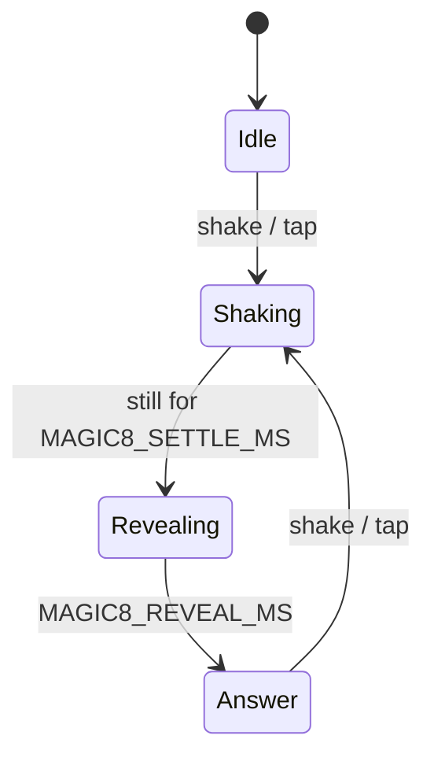

# Magic 8-ball

## Purpose

Ask a yes/no question, shake the device (or tap the ball), and read the
answer. The 20 classic answers (10 yes, 5 maybe, 5 no), drawn in the
spirit of the Far Cry 3 menus: rough white brush lettering on a red
paint swipe, over a dark background.

## Look

- **Font:** Permanent Marker (Apache 2.0), a hand-painted brush
  capital. Far Cry 3's own lettering is custom and not available, so this
  is the closest open font we could find.
- **Palette:** black background with a red halo around the ball
  (`MAGIC8_GLOW`, built up from faint concentric washes). The answer sits
  on a red brush swipe (`MAGIC8_COLOR`), in white.
- **The ball:** a 300 px near-black sphere with a faint rim and a soft
  highlight at the top left. Both are tinted slightly red: a neutral grey
  this dark turns green in RGB565. Idle, it shows the classic white disc
  with a black "8".
- **Swipe:** a rough-edged dry-brush stroke behind the answer, tilted −4°
  and wider than the ball. It's an A8 image (`assets/images/brush.png`,
  from `tools/gen_brush.py`), tinted in code.

## Screens

```
 Idle                          Shaking                      Answer
┌──────────────────────────┐  ┌──────────────────────────┐  ┌──────────────────────────┐
│                          │  │                          │  │                          │
│       .-""""""-.         │  │      .-""""""-.          │  │       .-""""""-.         │
│     .'   ____   '.       │  │    .'          '.        │  │     .'          '.       │
│    /    /    \    \      │  │   /   (dark)     \  ←→   │  │  ▓▓▓▓▓▓▓▓▓▓▓▓▓▓▓▓▓▓▓▓    │
│   |    |  8   |    |     │  │  |                |      │  │  ▓  OUTLOOK NOT     ▓    │
│    \    \____/    /      │  │   \              /       │  │  ▓    SO GOOD       ▓    │
│     '.          .'       │  │    '.          .'        │  │  ▓▓▓▓▓▓▓▓▓▓▓▓▓▓▓▓▓▓▓▓    │
│       '-......-'         │  │      '-......-'          │  │       '-......-'         │
│                          │  │                          │  │                          │
│   ASK. THEN SHAKE.       │  │        . . .             │  │      ASK AGAIN           │
└──────────────────────────┘  └──────────────────────────┘  └──────────────────────────┘
```

Simulator frames: `docs/design/screens/52-magic8-idle.png` … `54-magic8-answer.png`.

- **Idle:** the ball with the "8". The caption at the bottom reads "ASK. THEN
  SHAKE." in the brush font, dim.
- **Shaking:** the ball follows the shake: it jitters a few px, and the
  window turns dark ("the answer sinks").
- **Answer:** once the device has been still for `MAGIC8_SETTLE_MS`, the
  answer surfaces across the ball. The swipe and text fade in, grow from
  85 % to 100 % and rise 18 px over `MAGIC8_REVEAL_MS`, like the die
  floating up in a real ball. The caption becomes "ASK AGAIN".

## Interaction

| Input | Effect |
| --- | --- |
| Shake (≥ 3 jolts of ≥ `MAGIC8_SHAKE_G` from 1 g within 800 ms) | starts shaking; the answer comes once it's still |
| Tap the ball | the same, without the shake (ball wobbles for 400 ms) |
| Back | menu |

No answer twice in a row. Answers are drawn uniformly from the hardware RNG.

## States



The shake detector and the answer picker are `lib/EightBall` (pure, tested).

## Power

- **Normal** policy: dims at 30 s and turns off at 40 s on battery. The
  screen changes with every question, so burn-in isn't a concern.
- **IMU:** on only while the app is open and the screen is on
  (`onScreen()`), at the Level app's settings. It's powered down on close
  and with the screen off.
- **Screen off:** nothing (`sleepNeed` empty), so the device deep-sleeps.

## Persistence

| What | Where |
| --- | --- |
| The last answer on screen | parked (RTC) on sleep: a wake shows it again |

Nothing in NVS.

## Config

```c
#define MAGIC8_COLOR 0xC8102E  // the paint swipe (and menu accent)
#define MAGIC8_GLOW 0x5A0A14   // the red halo (built up from faint washes)
#define MAGIC8_SHAKE_G 0.6f    // a jolt: |a| differs from 1 g by this much
#define MAGIC8_SETTLE_MS 500   // still this long after shaking: the answer surfaces
#define MAGIC8_REVEAL_MS 900   // the answer fading in
#define MAGIC8_SAMPLE_MS 20    // IMU reads while open (50 Hz)
#define MAGIC8_FPS 30          // while the ball shakes or the answer surfaces
```

## Errors

No IMU (it didn't answer at boot): the caption reads "TAP THE BALL", and
tapping still works.

## Acceptance (on device)

- [ ] Shaking gives an answer once the device is still; a gentle tilt doesn't.
- [ ] Tapping the ball gives an answer; never the same one twice in a row.
- [ ] The lettering reads well at arm's length; the swipe edges look rough, not blocky.
- [ ] Back closes it, and the IMU is powered down (the Level app's drain check).
- [ ] Sleep with an answer showing, then press Power: the same answer is on screen.

## Later

- A custom answer set (yes/no only, Czech answers).
- A short sound when the answer surfaces.
