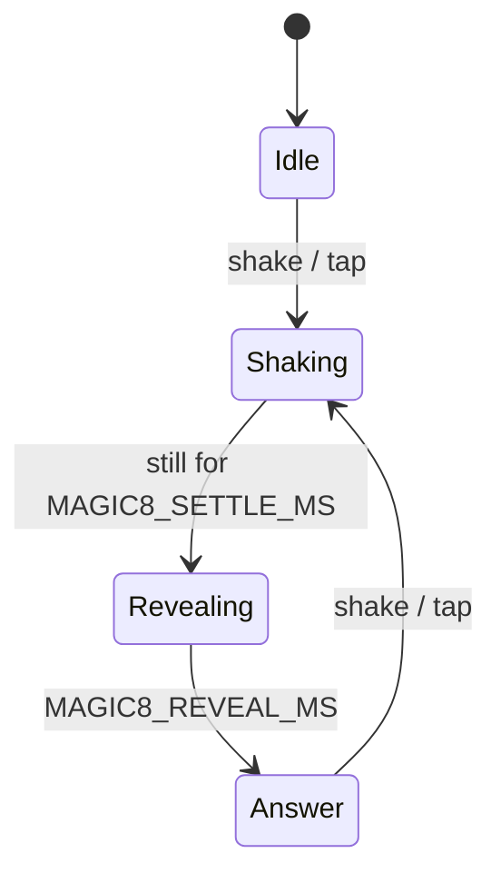

# Magic 8-ball

## Purpose

Ask a yes/no question, shake the device (or tap the screen), and read the
answer. A few of the classic answers and many funnier ones, each in its
own colour, in big rough brush capitals in the spirit of the Far Cry 3
menus. Nothing but text on black: no ball, no background behind the text.

## Look

- **Font:** Permanent Marker (Apache 2.0), a hand-painted brush capital,
  44 px for the answers and 30 px for the caption. Far Cry 3's own lettering
  is custom and not available, so this is the closest open font we could
  find.
- **Colour:** each answer has its own (`lib/EightBall`), all readable on
  black:
  - Yes answers lean green, gold and cyan.
  - The non-committal ones lean grey, purple and coffee.
  - No answers lean red.
- **Background:** black. The caption is dim grey.

## Screens

```
 Idle                          Shaking                      Answer
┌──────────────────────────┐  ┌──────────────────────────┐  ┌──────────────────────────┐
│                          │  │                          │  │                          │
│                          │  │                          │  │                          │
│        ASK ME            │  │      ASK ME   ←→         │  │      YES, BUT            │
│       ANYTHING           │  │     ANYTHING (fading)    │  │       WEAR A             │  (in yellow)
│                          │  │                          │  │       HELMET             │
│                          │  │                          │  │                          │
│       THEN SHAKE         │  │         . . .            │  │      SHAKE AGAIN         │
└──────────────────────────┘  └──────────────────────────┘  └──────────────────────────┘
```

Simulator frames: `docs/design/screens/52-magic8-idle.png` … `54-magic8-answer.png`.

- **Idle:** "ASK ME / ANYTHING" in white. The caption reads "THEN SHAKE".
- **Shaking:** whatever was on screen (the prompt or the last answer)
  rattles sideways and fades to a quarter, sinking into the dark. The
  caption becomes ". . .".
- **Answer:** once the device has been still for `MAGIC8_SETTLE_MS`, the
  answer surfaces in its colour: it fades in and rises 24 px with a small
  overshoot over `MAGIC8_REVEAL_MS`, like the die floating up in a real
  ball. The caption becomes "SHAKE AGAIN".

## Answers

| Kind | Answer (colour) |
| --- | --- |
| Yes (10) | IT IS CERTAIN (white) · WITHOUT A DOUBT (green) · YES. OBVIOUSLY. (gold) · SIGNS POINT TO YES (cyan) · THE STARS SAY YES (lavender) · HELL YES! (ember) · DO IT. NO REGRETS. (orange) · MOST LIKELY (white) · YES, BUT WEAR A HELMET (yellow) · 100 %. TRUST ME. (green) |
| Maybe (6) | ASK AGAIN LATER (grey) · REPLY HAZY, TRY AGAIN (lavender) · ASK YOUR CAT (pink) · NEED COFFEE FIRST (crema) · CONCENTRATE AND ASK AGAIN (blue) · FLIP A COIN. I'M BUSY. (amber) |
| No (6) | DON'T COUNT ON IT (red) · NOPE. (bright red) · VERY DOUBTFUL (salmon) · NOT IN THIS TIMELINE (magenta) · ABSOLUTELY NOT (red) · MY SOURCES SAY NO (red-orange) |

Line breaks and exact colours are in `lib/EightBall/src/eight_ball.cpp`.
The simulator checks that every line fits the screen.

## Interaction

| Input | Effect |
| --- | --- |
| Shake (≥ 3 jolts of ≥ `MAGIC8_SHAKE_G` from 1 g within 800 ms) | starts shaking; the answer comes once it's still |
| Tap anywhere | the same, without the shake (a 450 ms rattle) |
| Back | menu |

Never the same answer twice in a row. Answers are drawn uniformly from the
hardware RNG.

## States



The shake detector and the answers are `lib/EightBall` (pure, tested).

## Power

- **Normal** policy: dims at 30 s and turns off at 40 s on battery. Only
  text is lit, and it changes with every question.
- **IMU:** on only while the app is open and the screen is on
  (`onScreen()`). It's powered down on close and with the screen off.
- **Screen off:** nothing (`sleepNeed` empty), so the device deep-sleeps.

## Persistence

| What | Where |
| --- | --- |
| The last answer on screen | parked (RTC) on sleep: a wake shows it again |

Nothing in NVS.

## Config

```c
#define MAGIC8_COLOR 0xC8102E  // menu accent
#define MAGIC8_SHAKE_G 0.6f    // a jolt: |a| differs from 1 g by this much
#define MAGIC8_SETTLE_MS 500   // still this long after shaking: the answer surfaces
#define MAGIC8_REVEAL_MS 900   // the answer fading in
#define MAGIC8_SAMPLE_MS 20    // IMU reads while open (50 Hz)
#define MAGIC8_FPS 30          // while the text rattles or the answer surfaces
```

## Errors

No IMU (it didn't answer at boot): the captions read "THEN TAP" and "TAP
AGAIN", and tapping works.

## Acceptance (on device)

- [ ] Shaking gives an answer once the device is still; a gentle tilt doesn't.
- [ ] A tap gives an answer; never the same one twice in a row.
- [ ] The lettering reads well at arm's length; every colour is easy to read on black.
- [ ] Back closes it, and the IMU is powered down.
- [ ] Sleep with an answer showing, then press Power: the same answer is on screen.

## Later

- More answer sets (classic only, Czech).
- A short sound when the answer surfaces.
