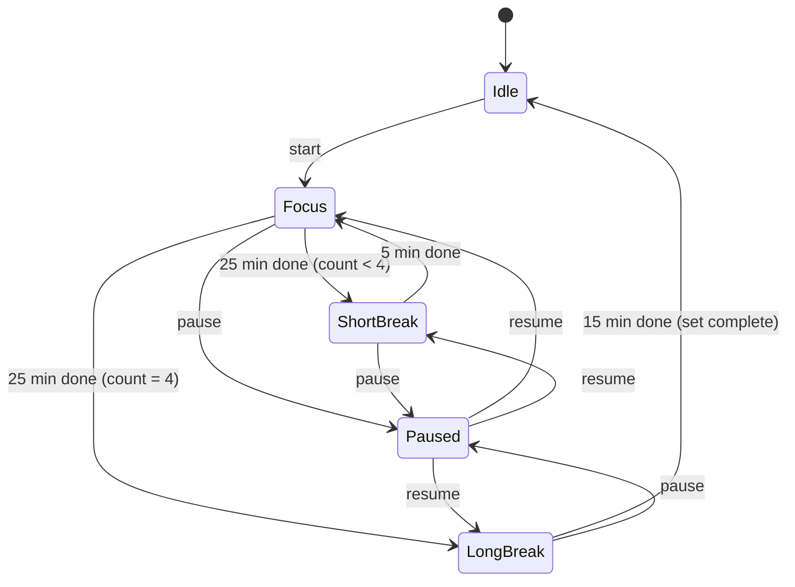

# Pomodoro

## Purpose

A Pomodoro timer: focus sessions separated by breaks. It must keep showing
the countdown for 25+ minutes on a small battery, so instead of sleeping it
uses a **minimal display mode**: few dim pixels, rare refreshes, CPU in light
sleep between them.

## The technique

The classic rules (Francesco Cirillo):

1. Focus for **25 min** (one "pomodoro").
2. Short break **5 min**.
3. After **4 pomodoros**, a long break of **15–30 min** (default 15).
4. Repeat.

All durations are configurable.

## Screens

**Full view** (after any interaction):

```
┌──────────────────────────┐
│   FOCUS        ● ● ○ ○   │  phase + completed pomodoros in this set
│                          │
│        ╭────────╮        │
│      ╱            ╲      │  progress ring (thin, phase colour:
│     │    18:42     │     │   focus = tomato red, break = green,
│      ╲            ╱      │   long break = blue)
│        ╰────────╯        │
│                          │
│   [ ❚❚ pause ]  [ ⟲ ]    │  pause/resume, reset; skip via long press
└──────────────────────────┘
```

**Minimal view** (after the dim timeout while running):

```
┌──────────────────────────┐
│                          │
│                          │
│           18             │  minutes only, small, dim, phase colour
│        ·········         │  thin dotted arc = remaining time
│                          │
│                          │
└──────────────────────────┘  ~1–3 % of the pixels lit
```

- Redraws **once per minute** (minutes only, no seconds), plus once at each
  phase change.
- The position drifts a few pixels on every refresh (burn-in).
- Brightness ~15 %.
- Between refreshes: LVGL idle, Wi-Fi off, **ESP32-S3 light sleep** with a
  timer wake at the next minute boundary. The AMOLED keeps showing the last
  frame from its own RAM.
- Touch or a button wakes it from light sleep → full view at normal brightness
  (that touch is swallowed).

## Interaction

| Input | Effect |
| --- | --- |
| Tap ring / pause button | start ↔ pause |
| Reset button | reset the current phase (confirm by tapping twice) |
| Long-press ring | skip to the next phase |
| Back / Home | back to the menu, **timer keeps running** in the background; reopening shows it |
| Long press (sleep) | timer is saved as **paused**; resume after waking |

## States



Pure logic (no LVGL/Arduino) so it can be unit-tested on the PC. Time is
tracked as an absolute end timestamp (`esp_timer` / RTC), not by counting
ticks, so light sleep can't make it drift.

**Phase end:** short beep pattern on the speaker (ES8311, amp on only while
beeping), full view for 10 s at normal brightness, then the next phase
starts automatically (`POMO_AUTO_START_NEXT`) or waits for a tap.

## Power

- Running → `LowPowerDisplay`: never deep sleep; the dim timeout switches to
  the minimal view instead of dim → black → sleep.
- Idle / paused → `Normal` (the device may sleep; a paused timer is saved).
- Running in the background (user went back to the menu): the policy still
  applies. When the menu would go to sleep, the device shows the pomodoro
  minimal view instead.
- **On the charger it behaves exactly as on battery**: minimal view after
  the battery dim delay. Only the charger's 80 % brightness cap still
  applies (policies beat profiles, ARCHITECTURE §3.1).

Rough budget to verify on hardware: a minimal view with ~2 % of pixels lit at
low brightness, plus light sleep, should draw a few mA versus ~100 mA fully
awake. Measure and record in HARDWARE.md.

## Persistence

`onSleep()` pauses a running timer and saves `pomo::Saved` (phase, running
flag, pomodoros completed, remaining ms) to NVS (key `pomo`); it is restored
when the app next runs. Daily stats come later.

## Config

```cpp
// ---- pomodoro ----
#define POMO_FOCUS_MIN          25
#define POMO_SHORT_BREAK_MIN    5
#define POMO_LONG_BREAK_MIN     15
#define POMO_SET_SIZE           4
#define POMO_AUTO_START_NEXT    1
#define POMO_SOUND              1
```

The minimal view's brightness is `BRIGHTNESS_MINIMAL` (38, ~15 %) in the
power-profile block of `config.h`.

## Acceptance (on device)

- [ ] Full 25/5 cycle completes with correct timing (±2 s over 25 min)
- [ ] Minimal view appears after the dim timeout; it updates every minute and drifts
- [ ] Touch in the minimal view → full view, without pausing the timer
- [ ] Device never deep-sleeps while a timer runs; it does when idle/paused
- [ ] Beep at phase end; amp is off otherwise (no hiss)
- [ ] Current in the minimal view measured and recorded

## Later

Daily stats view, custom presets, task label, Home Assistant hook (e.g. set a
"focus" light colour during focus).
