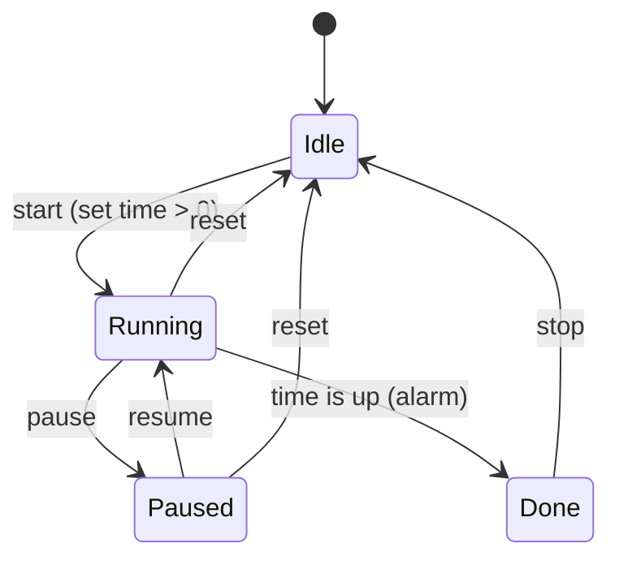

# Timer

## Purpose

A big clock you can read across the room while presenting, a stopwatch, and
a countdown up to 99:59. On the clock the screen never goes off: it drops to
a dim, slowly moving minimal view so the battery lasts and the AMOLED doesn't
burn in.

## Screens

Three tabs, switched with the segmented control at the top.

```
 Clock                         Stopwatch                     Countdown: set
┌──────────────────────────┐  ┌──────────────────────────┐  ┌──────────────────────────┐
│ [Clock|Stopwatch|Countd.]│  │ [Clock|Stopwatch|Countd.]│  │ [Clock|Stopwatch|Countd.]│
│                          │  │                          │  │      ⌃           ⌃       │
│           18             │  │                          │  │                          │
│                          │  │       01:15.3            │  │      06    :    54       │  drag a column,
│           11             │  │       running            │  │                          │  or tap above /
│                          │  │                          │  │      ⌄           ⌄       │  below its middle
│       Sat 10 Oct         │  │   [ ❚❚ Pause ]           │  │     min         sec      │
│                          │  │                          │  │      [ ▶ Start ]         │
└──────────────────────────┘  └──────────────────────────┘  └──────────────────────────┘
  hours white, minutes in        tenths small; h:mm:ss        0:00 can't start
  the accent (160 px digits)     from an hour (no tenths)

 Countdown: running            Countdown: time's up          Minimal view (clock)
┌──────────────────────────┐  ┌──────────────────────────┐  ┌──────────────────────────┐
│ [Clock|Stopwatch|Countd.]│  │ [Clock|Stopwatch|Countd.]│  │                          │
│        ╭────────╮        │  │        ╭────────╮        │  │      18                  │
│      ╱   00:50    ╲      │  │      ╱   -0:04    ╲      │  │                          │
│     │   ends 18:12 │     │  │     │  time's up   │     │  │      11                  │  dim (25 %), moves
│      ╲            ╱      │  │      ╲            ╱      │  │                          │  every minute
│        ╰────────╯        │  │        ╰────────╯        │  │                          │
│   [ ❚❚ Pause ]  [ ⟲ ]    │  │      [ ⊗ Stop ]          │  │                          │
└──────────────────────────┘  └──────────────────────────┘  └──────────────────────────┘
  ring = time gone;             amber, counts the overtime   no tabs, no buttons
  "ends" = wall-clock end
```

Simulator frames: `docs/design/screens/32-timer-clock.png` …
`37-timer-countdown-done.png`.

## Interaction

| Input | Effect |
| --- | --- |
| Tap a tab | switch view; the timers keep running whatever is shown |
| Stopwatch: tap the digits / Start / Pause / Resume | start ↔ pause |
| Stopwatch: ⟲ (shown while paused) | back to 00:00.0 |
| Countdown, set: drag a column up / down | count up / down, 16 px a step; minutes 0–99 and seconds 0–59 wrap, no carry |
| Countdown, set: tap above / below a column's middle (hold to repeat) | +1 / −1 |
| Countdown: Start, tap the ring, Pause / Resume | start ↔ pause |
| Countdown: ⟲ (running or paused) | back to the set time |
| Countdown, time's up: Stop or tap the ring | back to the set time |
| Back | silences a ringing alarm first; otherwise to the menu (timers keep running) |
| Opening the app while a countdown has finished | silences the alarm, shows the Countdown tab |

## States



The stopwatch is just running / paused / zero. Both are `lib/TimerCore`
(host-tested) and keep absolute timestamps on a 64-bit clock
(`core::extend`), so light sleep and the 49-day `millis()` wrap don't make
them drift.

**Time's up:** the alarm (four quick beeps) repeats every 2 s for 30 s, the
screen wakes (it leaves a minimal view) and flashes, and the Timer switches to
the Countdown tab if it's open. The display then counts the overtime until
you press Stop.

## Power

| What's going on | Policy |
| --- | --- |
| Clock tab open | `LowPowerDisplay`: never off by itself, only by Power |
| Stopwatch or countdown running (or a finished countdown not yet stopped), open or in the background | `LowPowerDisplay` |
| Otherwise | `Normal` |

**Minimal view** (after the battery dim delay, on the charger too): no tabs
and no buttons, just the digits, at `TIMER_MINIMAL_BRIGHTNESS` (25 %,
brighter than the Pomodoro's 15 % so it reads across a room; never above the
user's brightness). It shows what the open tab shows; from the background,
a running countdown, else the stopwatch.

- **Clock:** hours over minutes in 160 px digits. Redraws at each wall-clock
  minute; the CPU light-sleeps in between (waking at most every 5 s to poll
  the charger, ARCHITECTURE §8.3).
- **Countdown / stopwatch:** mm:ss and a small caption, redrawn each second.
- Every minute the digits move to a new spot (±40 px across, ±50 px / ±110 px
  down) so no pixel stays lit; only about 5 % of the pixels are on.

## Persistence

NVS key `timer`: the countdown's set time and the last tab.

**Screen off** (Power): both timers carry on, parked in RTC memory as they
are (their clock, `core::mono()`, counts on through deep sleep). A running
countdown asks for a wake at its end (`sleepNeed()`): the device deep-sleeps
until then, wakes with the screen dark, and the countdown rings and comes to
the front with the screen on (`manager::attention()`). A stopwatch needs
nothing: it just reads right after the wake. The alarm also comes to the
front when it ends while another app is open. Power (screen off) or Back
silences it.

**Power-off** (Power held): both timers pause and come back paused.

## Config

```cpp
// ---- timer (docs/apps/timer.md) ----
#define TIMER_COLOR 0xB388FF
#define TIMER_DEFAULT_COUNTDOWN_S 300   // until one is set
#define TIMER_MINIMAL_BRIGHTNESS 64     // 25 %
#define TIMER_ALARM_REPEAT_MS 2000
// ---- sound ----
#define SOUND_ALARM_MS 30000            // how long the alarm repeats
```

## Errors

No valid time yet (RTC lost and no Wi-Fi): the clock shows `--` `--` and
"Time not set: connect Wi-Fi"; the countdown shows "running" instead of the
end time.

## Acceptance (on device)

- [ ] Clock readable from 3 m in the minimal view, in a lit room
- [ ] The minimal clock changes exactly at the minute and moves every minute;
      left for an hour, the device never blanks or sleeps
- [ ] Current in the clock's minimal view measured and recorded in HARDWARE.md
- [ ] Stopwatch and countdown keep time (±1 s over 30 min) across minimal views
- [ ] A countdown finishing in the background wakes the screen and beeps;
      opening the app or Back silences it
- [ ] Wheels: drags and taps feel right; hold repeats

## Later

Laps, 12-hour clock, seconds on the big clock (a thin progress ring), preset
countdowns, an alarm at a time of day.
